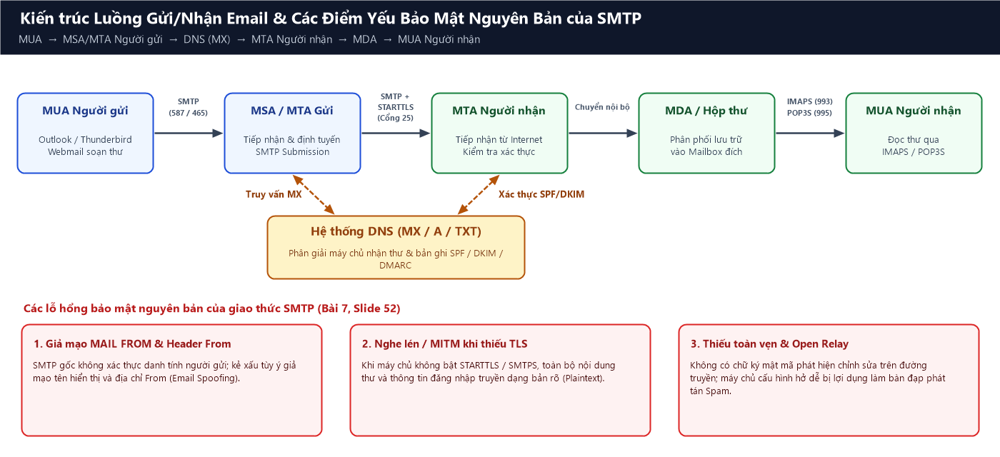

# Chương 1: Tổng quan về Bảo mật Thư điện tử

> **Sinh viên thực hiện:** Bùi Quang Tùng (`20120397`)  
> **Tài liệu môn học tham khảo:** `L1-Introduction to Cybersecurity.pptx` (S8-S19), `Bài 2 - Networking Essentials - Review.pptx` (S8-S19, S40-S44), `Bai 7 - Web - DHCP - DNS - Email Security.pptx` (S29-S37, S50-S53)

---

## 1.1. Đặt vấn đề & Thực trạng An ninh Thư điện tử

Thư điện tử (Email) vẫn là kênh trao đổi công việc phổ biến nhất tại các doanh nghiệp, ngân hàng, trường học và cơ quan hành chính. Tuy nhiên, theo nội dung bài giảng trên lớp (*Bai 7*, Slide 50-51; *Bài 8*, Slide 31), đây cũng là con đường thuận lợi nhất để kẻ tấn công thực hiện lừa đảo trực tuyến (**Phishing**), giả mạo địa chỉ người gửi (**Email Spoofing**) và phát tán **tệp đính kèm chứa mã độc**.

Số liệu từ các báo cáo an ninh mạng gần đây phản ánh rõ thực tế này:
- Báo cáo **Verizon Data Breach Investigations Report (DBIR) 2025** cho biết có **60%** số vụ xâm phạm dữ liệu có liên quan đến yếu tố con người (*human element*), trong đó **30%** xuất phát từ việc đánh cắp/lạm dụng thông tin đăng nhập và **23%** liên quan đến kỹ nghệ xã hội như Phishing. Trước đó, **Verizon DBIR 2024** cũng ghi nhận thời gian trung vị từ khi người dùng mở một email lừa đảo đến khi nhấp vào liên kết chỉ mất **21 giây**, và thêm khoảng **28 giây** để điền thông tin cá nhân vào trang giả mạo.
- Theo báo cáo của **APWG (*Anti-Phishing Working Group*)** giai đoạn **2024-2025**, số lượng cuộc tấn công phishing ghi nhận mỗi năm duy trì ở mức **3,76 - 3,8 triệu vụ** (riêng Quý 2/2025 đạt **1.130.393 vụ**). Đối với hình thức lừa đảo giả mạo email doanh nghiệp (**BEC** - *Business Email Compromise*), số tiền yêu cầu chuyển khoản trung bình dao động từ **48.115 USD đến 128.980 USD** tùy từng quý.

Nhìn chung, rủi ro mất an toàn email xuất phát từ hai nguyên nhân chính:
1. **Hạn chế từ thiết kế ban đầu của giao thức SMTP:** Ra đời từ thập niên 1980, SMTP ưu tiên việc chuyển thư nhanh và đơn giản trên mạng tin cậy thay vì kiểm tra danh tính người gửi hay mã hóa dữ liệu.
2. **Thói quen của người dùng cuối:** Khi một nhân viên mất cảnh giác bấm vào đường dẫn lạ hoặc mở file đính kèm độc hại, các lớp tường lửa mạng bên ngoài hầu như không còn tác dụng ngăn chặn ban đầu.

---

## 1.2. Kiến trúc và Giao thức Hoạt động của Hệ thống Email

Một quá trình gửi và nhận thư điện tử tiêu chuẩn gồm ba thành phần phần mềm chính (**MUA**, **MSA/MTA**, **MDA**) phối hợp cùng các giao thức truyền nhận và dịch vụ phân giải tên miền DNS (*Bảng 1.1*):

| Thành phần / Giao thức | Chức năng trong luồng xử lý Email | Cổng mạng tiêu chuẩn |
| :--- | :--- | :--- |
| **MUA** (*Mail User Agent*) | Phần mềm phía người dùng dùng để soạn và đọc thư (Outlook, Thunderbird, Webmail). | - |
| **MSA / MTA** (*Mail Submission / Transfer Agent*) | Tiếp nhận thư từ MUA người gửi và định tuyến chuyển tiếp thư qua lại giữa các máy chủ mail. | TCP `25`, `587`, `465` |
| **MDA** (*Mail Delivery Agent*) | Nhận thư từ MTA đích và lưu vào hộp thư của người nhận. | - |
| **SMTP** (*Simple Mail Transfer Protocol*) | Giao thức đẩy (*push*) dùng để gửi thư từ MUA lên máy chủ và chuyển thư giữa các MTA. | `25` (giữa MTA), `587`/`465` (gửi từ client) |
| **POP3 / IMAP** | Giao thức tải/đồng bộ thư (*pull*) từ hộp thư máy chủ về thiết bị người nhận (`POP3S`, `IMAPS` khi dùng TLS). | POP3 `110`/`995`; IMAP `143`/`993` |
| **DNS (`MX`, `A/AAAA`)** | Cung cấp địa chỉ máy chủ nhận thư (*Mail Exchanger*) tương ứng với tên miền người nhận. | UDP/TCP `53` |

*Bảng 1.1: Thành phần và giao thức chính trong hệ thống Email.*


*Hình 1.1: Kiến trúc luồng gửi nhận thư điện tử & các điểm yếu bảo mật của SMTP.*

### Vai trò của bản ghi DNS `MX` khi định tuyến thư
Khi máy chủ MTA bên gửi cần chuyển thư tới một tên miền đích (chẳng hạn `gmail.com`), MTA sẽ truy vấn hệ thống DNS để lấy bản ghi `MX` (tương tự thao tác kiểm tra bằng công cụ `nslookup` trong *Bai 7*, Slide 42):

```powershell
nslookup -type=mx gmail.com
```
Kết quả trả về gồm hai thông số quan trọng:
- **`MX preference` (độ ưu tiên, ví dụ `5`, `10`, `20`):** Giá trị càng nhỏ thì máy chủ nhận thư đó càng được ưu tiên kết nối trước; các máy chủ có giá trị lớn hơn đóng vai trò dự phòng khi máy chủ chính quá tải hoặc ngừng hoạt động.
- **`mail exchanger` (ví dụ `gmail-smtp-in.l.google.com`):** Địa chỉ tên miền của máy chủ nhận thư để MTA gửi mở kết nối SMTP đến cổng TCP `25`.

---

## 1.3. Hạn chế Bảo mật của Giao thức SMTP Gốc

Dựa theo phân tích trong *Bai 7* (Slide 52), giao thức SMTP nguyên bản có bốn điểm yếu lớn thường bị kẻ xấu lợi dụng:
1. **Không kiểm tra xác thực địa chỉ gửi (`From`):** SMTP cho phép máy gửi tự khai báo bất kỳ địa chỉ nào ở lệnh `MAIL FROM` (trên phong bì giao vận) cũng như dòng tiêu đề `From:` hiển thị cho người đọc, tương tự việc ghi tên người gửi tùy ý ngoài bì thư giấy.
2. **Truyền dữ liệu dạng văn bản rõ (Plaintext) nếu thiếu TLS:** Khi kết nối giữa hai máy chủ mail không thương lượng mã hóa **STARTTLS / SMTPS**, nội dung email và thông tin tài khoản có nguy cơ bị nghe lén hoặc can thiệp trên đường truyền (*Man-in-the-Middle*).
3. **Không đảm bảo tính toàn vẹn (Integrity):** SMTP gốc không đính kèm chữ ký số cho tiêu đề và phần thân email, do đó người nhận khó biết được nội dung thư có bị sửa đổi khi đi qua các trạm trung chuyển hay không.
4. **Nguy cơ cấu hình sai Open Relay:** Nếu máy chủ SMTP cho phép mọi địa chỉ IP bên ngoài gửi thư chuyển tiếp không cần xác thực, kẻ tấn công có thể lợi dụng máy chủ đó để phát tán thư rác và email lừa đảo hàng loạt.

---

## 1.4. Mục tiêu Bảo mật Email theo Mô hình CIA Triad

Đối chiếu với ba thuộc tính cốt lõi của an toàn thông tin **CIA Triad** trong *L1-Introduction to Cybersecurity* (Slide 8-9) và *Bai 7* (Slide 50-56), một hệ thống email an toàn cần đáp ứng các yêu cầu tại *Bảng 1.2*:

| Mục tiêu bảo mật | Yêu cầu cụ thể đối với Email | Giải pháp kỹ thuật đáp ứng |
| :--- | :--- | :--- |
| **Confidentiality (Tính bí mật)** | Chỉ người gửi và người nhận đúng thẩm quyền mới đọc được nội dung thư. | `SMTPS / STARTTLS` (bảo vệ đường truyền), `PGP / S/MIME` (mã hóa đầu-cuối). |
| **Integrity (Tính toàn vẹn)** | Tiêu đề và nội dung thư không bị thay đổi trái phép trong quá trình vận chuyển. | Chữ ký số `DKIM`, `S/MIME`, `PGP`. |
| **Availability (Tính sẵn sàng)** | Dịch vụ gửi nhận thư hoạt động ổn định, giảm gián đoạn do thư rác hoặc tấn công DoS. | Bộ lọc chống Spam, giới hạn tốc độ gửi (Rate-limit), máy chủ MX dự phòng. |
| **Authentication (Tính xác thực)** | Xác minh máy chủ gửi và tên miền gửi thư đúng là chủ thể hợp pháp. | Bộ ba `SPF`, `DKIM`, `DMARC`, kết hợp `MTA-STS / DANE`. |

*Bảng 1.2: Đối chiếu mục tiêu bảo mật Email theo mô hình CIA Triad.*
