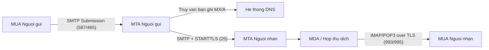

# Chương 1: Tổng quan về Bảo mật Thư điện tử

> **Phụ trách:** Thành viên 1 (Trưởng nhóm)  
> **Tài liệu tham chiếu:** `L1-Introduction to Cybersecurity.pptx` (S8–S19), `Bài 2 - Networking Essentials - Review.pptx` (S8–S19, S40–S44), `Bai 7 - Web - DHCP - DNS - Email Security.pptx` (S29–S37, S50–S53)

---

## 1.1. Đặt vấn đề & Bối cảnh An ninh Thư điện tử

Thư điện tử (Email) là phương tiện trao đổi thông tin chính thức trong doanh nghiệp, cơ quan nhà nước, ngân hàng và trường học. Theo nội dung học phần (*Bai 7*, Slide 50–51; *Bài 8*, Slide 31), Email vừa là kênh giao tiếp trọng yếu nhất của tổ chức, vừa là bề mặt tấn công phổ biến hàng đầu để kẻ xấu phát tán lừa đảo (**Phishing**), giả mạo danh tính (**Email Spoofing**) và phát tán **mã độc qua tệp đính kèm**.

Điểm yếu lớn nhất của bảo mật email không chỉ nằm ở lỗi phần mềm máy chủ, mà bắt nguồn từ hai nguyên nhân gốc rễ:
1. **Hạn chế lịch sử của giao thức SMTP:** Thiết kế từ thập niên 1980 ưu tiên khả năng chuyển tiếp thông suốt thay vì xác thực danh tính và bảo mật đầu-cuối.
2. **Yếu tố con người:** Chỉ cần một nhân viên bấm vào liên kết giả mạo hoặc mở tệp đính kèm chứa mã độc, toàn bộ lớp phòng thủ mạng phía ngoài có thể bị vượt qua.

---

## 1.2. Kiến trúc và Giao thức Hoạt động của Hệ thống Email

Một phiên gửi và nhận thư điện tử chuẩn Internet liên quan đến ba nhóm thành phần phần mềm và bốn giao thức chính:

| Thành phần / Giao thức | Vai trò trong luồng Email | Cổng mặc định |
| :--- | :--- | :--- |
| **MUA** (*Mail User Agent*) | Ứng dụng phía người dùng để soạn và đọc thư (Outlook, Thunderbird, Webmail). | — |
| **MSA / MTA** (*Mail Submission / Transfer Agent*) | Tiếp nhận thư từ MUA và định tuyến chuyển tiếp thư giữa các miền máy chủ. | TCP `25`, `587`, `465` |
| **MDA** (*Mail Delivery Agent*) | Tiếp nhận thư đến hộp thư đích của người nhận trên máy chủ nhận. | — |
| **SMTP** (*Simple Mail Transfer Protocol*) | Giao thức đẩy (*push*) dùng để gửi thư từ MUA đến MSA và giữa các MTA. | `25` (MTA-MTA), `587`/`465` (Submission) |
| **POP3 / IMAP** | Giao thức truy xuất thư (*pull*) từ hộp thư máy chủ về MUA người nhận (`POP3S`, `IMAPS` khi bọc TLS). | POP3 `110`/`995`; IMAP `143`/`993` |
| **DNS (`MX`, `A/AAAA`)** | Trả lời địa chỉ máy chủ nhận thư (*Mail Exchanger*) của tên miền đích. | UDP/TCP `53` |

*Hình 1.1: Kiến trúc tổng quan luồng truyền tải và truy xuất thư điện tử.*

---

## 1.3. Lỗ hổng Bảo mật Nguyên bản của SMTP
1. **Không có cơ chế xác thực trường `From` mặc định:** Giao thức SMTP cho phép bên gửi khai báo bất kỳ chuỗi nào trong phần `MAIL FROM` (lệnh phong bì) và tiêu đề `From:` hiển thị cho người dùng, giống như việc viết tùy ý tên người gửi lên mặt sau một phong bì thư giấy.
2. **Truyền dữ liệu dạng bản rõ (Plaintext) trước TLS:** Khi kết nối giữa hai MTA không kích hoạt **STARTTLS / SMTPS**, toàn bộ nội dung thư và thông tin đăng nhập có thể bị nghe lén hoặc chỉnh sửa trên đường truyền (*Man-in-the-Middle*).
3. **Thiếu bảo vệ tính toàn vẹn (Integrity):** SMTP nguyên bản không gắn chữ ký mật mã cho tiêu đề hoặc nội dung, nên không phát hiện được việc email bị thay đổi ở các nút trung gian.
4. **Rủi ro cấu hình Open Relay:** Máy chủ SMTP cấu hình sai cho phép bất kỳ IP bên ngoài nào gửi thư chuyển tiếp, trở thành bàn đạp phát tán thư rác và lừa đảo quy mô lớn.

---

## 1.4. Mục tiêu Bảo mật Email theo Mô hình CIA Triad

| Thuộc tính bảo mật | Ý nghĩa đối với Thư điện tử | Cơ chế kỹ thuật tương ứng |
| :--- | :--- | :--- |
| **Confidentiality (Bảo mật)** | Chỉ người gửi và người nhận hợp lệ mới đọc được nội dung thư. | `SMTPS / STARTTLS` (trên đường truyền), `PGP / S/MIME` (đầu-cuối). |
| **Integrity (Toàn vẹn)** | Nội dung và tiêu đề quan trọng không bị chỉnh sửa trái phép khi truyền. | Chữ ký số `DKIM`, `S/MIME`, `PGP`. |
| **Availability (Sẵn sàng)** | Hệ thống thư hoạt động liên tục, không bị tê liệt bởi Spam/Bom thư/DoS. | Bộ lọc Spam/Rate-limit, dự phòng MX, chống mã độc. |
| **Authentication (Xác thực)** | Xác minh đúng tổ chức/tên miền thực sự sở hữu quyền gửi email. | `SPF`, `DKIM`, `DMARC`, `MTA-STS / DANE`. |

---

## Checklist Hoàn thiện Chương 1 (TV1)

- [ ] **[TODO (TV1)]:** Bổ sung 1–2 số liệu thống kê mới (kèm trích dẫn nguồn uy tín như Verizon DBIR / APWG / Bộ TT&TT) vào Mục 1.1 để tăng tính thuyết phục cho phần Đặt vấn đề.
- [ ] **[TODO (TV1)]:** Vẽ hoặc xuất sơ đồ *Hình 1.1* thành file ảnh `report/assets/ch1_email_architecture.png` nếu cần nộp bản Word/PDF không hỗ trợ render Mermaid trực tiếp.
- [ ] **[TODO (TV1)]:** Chụp minh họa một phiên kiểm tra bản ghi `MX` cơ bản bằng `nslookup -type=mx ...` để làm rõ vai trò DNS trong Mục 1.2.
