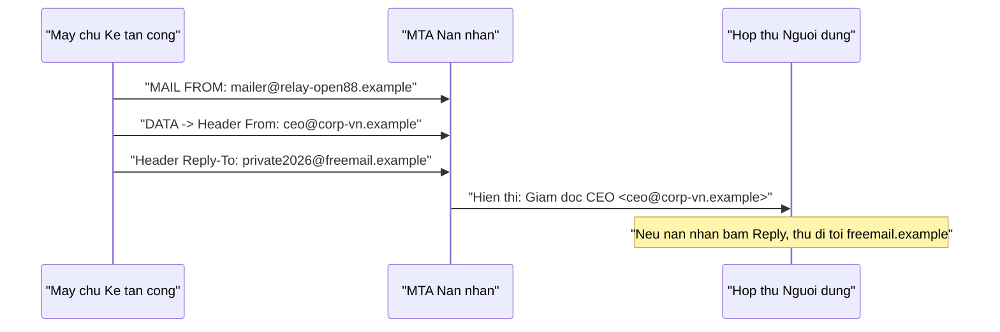

# Chương 2: Phân tích các Cuộc tấn công Giả mạo và Lừa đảo qua Email

> **Phụ trách:** Thành viên 2 (Threat & Malware Analyst)  
> **Tài liệu tham chiếu:** `Bai 7` (S43–S45, S50–S52), `Bài 8 - Malicious Code.pptx` (S3–S8, S18, S25, S29–S38), `L1` (S29, S33)

---

## 2.1. Tấn công Phishing (Lừa đảo Trực tuyến)

**Phishing** là hình thức tấn công kỹ nghệ xã hội (*Social Engineering*) qua email nhằm đánh cắp thông tin nhạy cảm (mật khẩu, mã OTP, thẻ ngân hàng) hoặc dụ nạn nhân thực hiện hành động gây thiệt hại tài chính.

### 2.1.1. Phân loại các Biến thể Phishing Phổ biến
- **Bulk Phishing:** Gửi hàng loạt tới hàng nghìn địa chỉ dựa trên các mẫu chung (thông báo trúng thưởng, giao hàng, khóa tài khoản ngân hàng).
- **Spear Phishing:** Nhắm vào một cá nhân hoặc phòng ban cụ thể sau khi kẻ tấn công đã thu thập thông tin về chức vụ, dự án và đồng nghiệp của nạn nhân.
- **Whaling:** Biến thể của Spear Phishing nhắm vào lãnh đạo cấp cao (CEO, CFO, Giám đốc nhân sự) — những người có quyền phê duyệt tài chính hoặc truy cập dữ liệu tối mật.
- **BEC (*Business Email Compromise*):** Giả danh sếp, đối tác hoặc nhà cung cấp để yêu cầu kế toán chuyển khoản gấp hoặc đổi số tài khoản thanh toán hợp đồng (minh họa ở `sample_03_spoofing_ceo_bec.eml`).
- **Clone Phishing:** Sao chép nguyên văn một email hợp lệ từng gửi trước đó rồi thay thế liên kết hoặc tệp đính kèm sạch bằng phiên bản độc hại.

### 2.1.2. Các Đòn tâm lý Social Engineering Thường gặp
1. **Tạo áp lực khẩn cấp (*Urgency*):** *"Xác minh trong 02 giờ"*, *"Thanh toán trước 11:00 trưa nay"* nhằm khiến nạn nhân hành động vội vàng, bỏ qua quy trình kiểm chứng.
2. **Đe dọa sợ hãi (*Fear*):** Cảnh báo khóa tài khoản vĩnh viễn, vi phạm chính sách, khóa hợp đồng.
3. **Lạm dụng quyền lực (*Authority*):** Mạo danh Tổng Giám đốc, bộ phận IT hoặc cơ quan quản lý, kèm yêu cầu *"giữ bí mật, không trao đổi với phòng khác"*.
4. **Kích thích lòng tham / tò mò (*Greed / Curiosity*):** Thông báo thưởng lương, hoàn thuế, biên lai chuyển tiền bất ngờ.

---

## 2.2. Tấn công Email Spoofing (Giả mạo Địa chỉ Người gửi)

Cấu trúc gửi thư SMTP phân biệt hai khái niệm địa chỉ hoàn toàn tách biệt:
- **Envelope From (`MAIL FROM` / `Return-Path`):** Địa chỉ dùng ở tầng giao vận SMTP để định tuyến và nhận thông báo lỗi trả về (*bounce*), thường bị ẩn khỏi giao diện chính của người dùng.
- **Header From (`From:`):** Địa chỉ và tên hiển thị xuất hiện trực tiếp trong hộp thư đến của nạn nhân.

*Hình 2.1: Cơ chế tách biệt Envelope From, Header From và Reply-To trong Email Spoofing.*

Các kỹ thuật Spoofing chính gồm:
1. **Giả mạo trực tiếp `Header From`:** Gửi thư mang địa chỉ tổ chức uy tín khi tên miền đó chưa bật `DMARC` mức `quarantine/reject`.
2. **Display Name Spoofing:** Đặt phần tên hiển thị là `"Giam doc Tran Minh Quan"` hoặc thậm chí chèn chuỗi email giả vào phần tên, trong khi địa chỉ thật bên trong ngoặc `<...>` thuộc tên miền khác.
3. **Đánh tráo `Reply-To`:** Thiết lập `Reply-To` sang hộp thư cá nhân do kẻ tấn công kiểm soát để thu nhận câu trả lời của nạn nhân mà không bị máy chủ công ty chính phát hiện.
4. **Lợi dụng Open Relay:** Gửi thư qua các máy chủ SMTP cấu hình hở để che giấu nguồn gốc.

---

## 2.3. Tấn công Giả mạo Tên miền (Lookalike / Domain Spoofing)

Khi tên miền mục tiêu đã bảo vệ `From` chặt chẽ bằng DMARC, kẻ tấn công chuyển sang đăng ký tên miền nhìn gần giống để đánh lừa thị giác:

| Kỹ thuật giả mạo | Cơ chế thực hiện | Ví dụ minh họa an toàn (`.example`) |
| :--- | :--- | :--- |
| **Typosquatting** | Thay chữ cái dễ nhầm (`l`↔`1`, `rn`↔`m`, thiếu/thừa ký tự). | `micorsoft.example`, `vcb-bamk.example` |
| **Combosquatting** | Ghép tên thương hiệu với từ khóa tạo cảm giác uy tín. | `vcb-security-check.example`, `corp-vn-support.example` |
| **Homograph / IDN Punycode** | Dùng ký tự Unicode (Cyrillic/Hy Lạp) giống hệt Latin; tầng DNS mã hóa thành tiền tố `xn--`. | `xn--micrsoft-7ya.example` *(Mẫu 4)* |
| **Subdomain Trick** | Đưa tên thương hiệu hợp lệ làm subdomain phía trước tên miền lạ. | `login.microsoft.example.account-reset-portal.example` |

Ngoài ra, theo *Bai 7* (Slide 43–46), nếu hệ thống phân giải tên miền bị tấn công **DNS Cache Poisoning**, ngay cả khi người dùng gõ đúng tên miền hợp lệ, bộ nhớ đệm DNS bị đầu độc vẫn có thể điều hướng lưu lượng sang máy chủ giả mạo nếu thiếu **DNSSEC**.

---

## 2.4. Tệp đính kèm Độc hại (Malicious Attachments)

Theo *Bài 8 - Malicious Code* (Slide 31), Email là kênh lây lan mã độc hàng đầu. Kẻ tấn công thường sử dụng bốn thủ thuật giao nhận tệp đính kèm nguy hiểm:
1. **Macro Virus (`.docm`, `.xlsm`, `.pptm`):** Nhúng mã VBA độc hại trong tài liệu Office (*Bài 8*, Slide 18) và dụ người dùng nhấn *"Enable Content / Enable Macros"* để tải payload giai đoạn sau.
2. **Phần mở rộng kép (*Double Extension*):** Đặt tên dạng `BienLai_ThanhToan_2026.pdf.exe` hoặc `.docx.scr`. Trên hệ điều hành ẩn đuôi file phổ biến, người dùng chỉ nhìn thấy `.pdf` và nhầm tưởng là tài liệu an toàn.
3. **Tệp nén đặt mật khẩu (`.zip`, `.rar`, `.7z`, `.iso`):** Đính kèm tệp nén mã hóa kèm mật khẩu ngay trong nội dung email nhằm vô hiệu hóa bộ quét chữ ký (*Signature*) tại Email Gateway.
4. **HTML Smuggling (`.html`, `.htm`):** Nhúng mã JavaScript tạo file nhị phân ngay trên trình duyệt nạn nhân khi mở tệp HTML đính kèm, né kiểm soát lưu lượng mạng.

Payload sau khi kích hoạt thường là **Trojan Horse** (*Bài 8*, Slide 25), **Spyware / Keylogger** đánh cắp mật khẩu (*Slide 29*), **Ransomware** mã hóa dữ liệu hoặc biến máy trạm thành **Botnet Zombie** (*Slide 30*). Việc phát hiện dựa trên kết hợp **Static Analysis** (kiểm tra hash, chữ ký, cấu trúc header PE/Macro) và **Dynamic Analysis / Sandboxing** (chạy thử tệp trong máy ảo cô lập để quan sát hành vi file, registry và kết nối mạng — *Bài 8*, Slide 33, 38).

---

## 2.5. Ma trận Dấu hiệu Nhận diện (Red Flags Matrix)

| Loại tấn công | Dấu hiệu ở Header / Auth | Dấu hiệu ở Tên miền / URL | Dấu hiệu ở Nội dung / Tệp đính kèm |
| :--- | :--- | :--- | :--- |
| **Phishing** | `SPF=FAIL` / `DMARC=FAIL`; lệch `Return-Path` | Anchor text khác URL đích; dùng `http://` | Đe dọa khóa tài khoản, đòi mật khẩu/OTP gấp |
| **Email Spoofing / BEC** | `Reply-To` trỏ sang mail miễn phí; `DMARC=FAIL` | Máy chủ gửi thuộc relay lạ không khớp tổ chức | Giả danh sếp, yêu cầu chuyển tiền & giữ bí mật |
| **Giả mạo tên miền** | Có thể `SPF=PASS` nếu hacker tự cấu hình miền giả | Có `xn--` (Punycode), sai chính tả, subdomain ≥ 4 cấp | Giả mạo thông báo đăng nhập bất thường |
| **Tệp đính kèm độc hại** | `SPF/DKIM/DMARC` thường fail hoặc từ miền lạ | Đính kèm link tải file ngoài hoặc HTML đính kèm | Đuôi kép `.pdf.exe`, `.docm`, dụ *Enable Macros* |

---

## Checklist Hoàn thiện Chương 2 (TV2)

- [ ] **[TODO (TV2)]:** Rà soát và đối chiếu từng mục phân tích với 6 file `.eml` mẫu đã tạo trong `labs/email_samples/` (bổ sung trích dẫn cụ thể ví dụ thực tế từ từng mẫu).
- [ ] **[TODO (TV2)]:** Xuất sơ đồ *Hình 2.1* hoặc chụp ảnh cấu trúc file `sample_03_spoofing_ceo_bec.eml` và `sample_05_malicious_attachment.eml` lưu vào `report/assets/ch2_*.png`.
- [ ] **[TODO (TV2)]:** *(Tùy chọn nâng cao)* Bổ sung 1 tiểu mục phân tích ngắn về **QR Code Phishing (Quishing)** — gửi ảnh mã QR độc hại trong email để né bộ lọc phân tích URL dạng văn bản.
