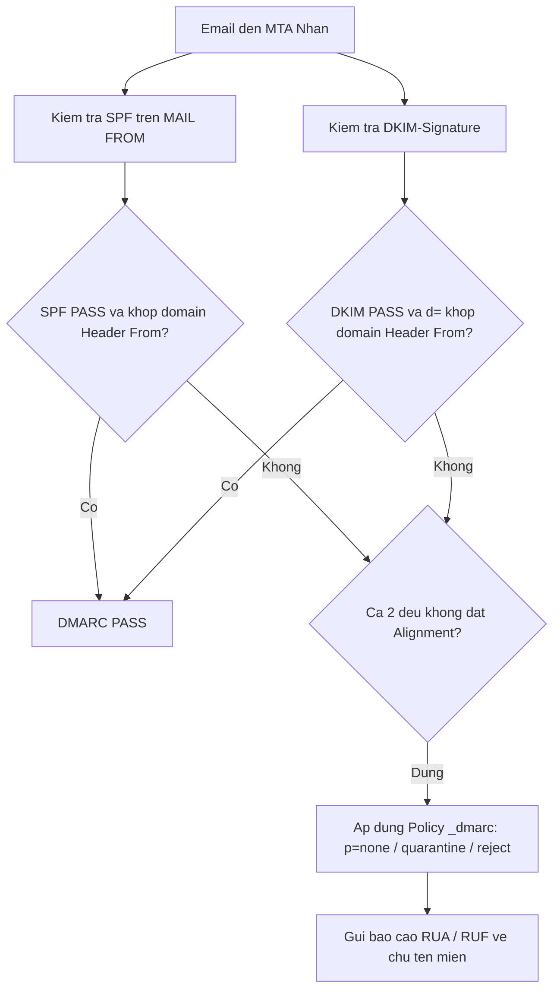

# Chương 3: Cơ chế SPF, DKIM, DMARC trong Xác thực Email

> **Sinh viên thực hiện:** Nguyễn Lê Hữu Điền (`23120233`)  
> **Tài liệu môn học tham khảo:** `Bai 7 - Web - DHCP - DNS - Email Security.pptx` (S29-S42, S50-S54), `Lab5. Web -DHCP-DNS-Email Security.docx`

---

## 3.1. Nền tảng DNS Records Phục vụ Xác thực Email

Theo *Bai 7* (Slide 37), hệ thống xác thực email hiện đại không thay đổi giao thức SMTP lõi mà tận dụng các bản ghi phân giải của **DNS** như một cơ sở dữ liệu công bố chính sách công khai:
- **`MX` (*Mail Exchanger*):** Xác định máy chủ chịu trách nhiệm nhận thư cho một tên miền.
- **`TXT` (*Text Record*):** Lưu trữ chuỗi văn bản chính sách **SPF** (tại tên miền gốc), khóa công khai **DKIM** (tại `<selector>._domainkey.<domain>`) và chính sách **DMARC** (tại `_dmarc.<domain>`).
- **`CNAME` (*Canonical Name*):** Thường dùng để ủy quyền bản ghi DKIM selector sang nhà cung cấp dịch vụ email bên thứ ba (như Microsoft 365, Google Workspace).
- **`PTR` (*Pointer Record*):** Dùng cho tra cứu ngược (*Reverse DNS*), giúp máy nhận kiểm tra IP gửi có khớp tên miền khai báo khi bắt tay SMTP (`HELO/EHLO`) hay không.

---

## 3.2. Cơ chế SPF (Sender Policy Framework — RFC 7208)

**SPF** cho phép chủ sở hữu tên miền công bố danh sách địa chỉ IP hoặc máy chủ được ủy quyền gửi email thay mặt cho tên miền `MAIL FROM` (Envelope From).

### Cú pháp tiêu biểu
```text
v=spf1 ip4:198.51.100.0/24 include:_spf.google.com mx -all
```
- `v=spf1`: Phiên bản giao thức SPF.
- Cơ chế cho phép: `ip4`, `ip6`, `a`, `mx`, `include:<domain>`.
- Bộ định danh xử lý cuối chuỗi: `-all` (*HardFail* — từ chối), `~all` (*SoftFail* — đánh dấu nghi ngờ), `?all` (*Neutral*), `+all` (*Pass all* — cấu hình sai cực kỳ nguy hiểm).

### Hạn chế của SPF
1. **Không bảo vệ trường `Header From`:** SPF chỉ kiểm tra tên miền ở tầng `MAIL FROM` (*Envelope From*). Kẻ tấn công vẫn có thể để `MAIL FROM` là miền của hắn (`SPF=PASS`) nhưng đặt `Header From` là tên miền nạn nhân.
2. **Bị gãy khi chuyển tiếp email (Email Forwarding):** Khi hộp thư trung gian tự động chuyển tiếp thư đi tiếp, IP kết nối tới đích cuối là IP của máy chủ chuyển tiếp chứ không còn là IP gốc.
3. **Giới hạn 10 lần tra cứu DNS (*10-DNS-lookup limit*):** Chuỗi `include` lồng nhau vượt quá 10 truy vấn DNS sẽ trả về lỗi `PermError`.

---

## 3.3. Cơ chế DKIM (DomainKeys Identified Mail — RFC 6376)

**DKIM** sử dụng mật mã khóa bất đối xứng (**RSA** hoặc **Ed25519**) để gắn chữ ký số vào email, bảo đảm hai thuộc tính: **Xác thực nguồn gốc** và **Toàn vẹn dữ liệu (*Integrity*)**.

- **Phía gửi:** MTA băm phần thân (*body hash* `bh=`) và các tiêu đề quan trọng (`From`, `Subject`, `Date`...), sau đó ký bằng **khóa bí mật (Private Key)** và đính kèm kết quả vào tiêu đề `DKIM-Signature` (`d=` là tên miền ký, `s=` là tên *selector*).
- **Phía nhận:** MTA truy vấn DNS lấy **khóa công khai (Public Key)** tại `<selector>._domainkey.<domain>` để xác minh chữ ký.
- **Ưu điểm & Hạn chế:** Chữ ký DKIM tồn tại xuyên suốt quá trình chuyển tiếp email (nếu nội dung/tiêu đề không bị sửa). Tuy nhiên, DKIM đứng riêng vẫn cho phép kẻ tấn công ký bằng một tên miền khác hoàn toàn với `Header From` và không quy định hành động chặn thư khi sai chữ ký.

---

## 3.4. Cơ chế DMARC (RFC 7489) & Mở rộng

**DMARC** (*Domain-based Message Authentication, Reporting, and Conformance*) kết hợp SPF và DKIM, bổ sung cơ chế **Identifier Alignment (Khớp định danh)** và chính sách xử lý thống nhất.


*Hình 3.1: Luồng kiểm tra SPF, DKIM và Identifier Alignment trong DMARC.*

### Các thành phần cốt lõi của DMARC
- **Identifier Alignment:** Yêu cầu tên miền ở `Header From` phải khớp (*Relaxed* `r` cho phép khớp subdomain; *Strict* `s` bắt buộc khớp chính xác) với ít nhất một trong hai miền đã xác thực (`MAIL FROM` của SPF hoặc `d=` của DKIM).
- **Chính sách (`p=`):** `p=none` (chỉ giám sát, không chặn), `p=quarantine` (đưa vào thư mục Spam/Cách ly), `p=reject` (từ chối nhận hoàn toàn); ngoài ra có `sp=` cho subdomain và `pct=` cho tỷ lệ phần trăm áp dụng.
- **Báo cáo (`RUA` / `RUF`):** `RUA` (Aggregate XML reports) gửi thống kê lưu lượng hợp lệ/giả mạo hàng ngày về cho quản trị viên; `RUF` (Forensic reports) gửi chi tiết mẫu vi phạm.
- **Lộ trình triển khai an toàn:** Bắt đầu từ `p=none` + thu thập `RUA` để rà soát dịch vụ gửi hợp pháp → nâng lên `p=quarantine` (tăng dần `pct`) → chốt `p=reject`.
- **Phần mở rộng:** **ARC** (*Authenticated Received Chain*) giữ nguyên trạng thái xác thực qua các máy chủ trung gian/mailing list; **BIMI** (*Brand Indicators for Message Identification*) hiển thị logo thương hiệu xác thực khi tên miền đạt DMARC `p=quarantine/reject`.

---

## 3.5. So sánh Tổng hợp & Kết quả Khảo sát DNS Thực tế

### Bảng 3.1: So sánh vai trò bổ trợ của SPF, DKIM và DMARC

| Tiêu chí | SPF (RFC 7208) | DKIM (RFC 6376) | DMARC (RFC 7489) |
| :--- | :--- | :--- | :--- |
| **Đối tượng kiểm tra** | IP máy gửi vs `MAIL FROM` | Chữ ký số trên Header & Body | Khớp định danh với `Header From` |
| **Nền tảng kỹ thuật** | Danh sách IP trên bản ghi `TXT` | Mật mã khóa công khai (RSA/Ed25519) | Kết hợp SPF + DKIM + Alignment |
| **Bảo vệ tính toàn vẹn** | Không | **Có** | Kế thừa từ DKIM |
| **Sống sót qua Forwarding** | Dễ gãy | **Có** (nếu không sửa nội dung) | **Có** (nhờ DKIM alignment) |
| **Chính sách chặn & Báo cáo** | Không có báo cáo | Không quy định chặn/báo cáo | **Có** (`none/quarantine/reject` + `RUA/RUF`) |

### Kết quả Khảo sát Cấu hình DNS Thực tế
- Nguồn thực nghiệm chi tiết đặt tại: [labs/dns_audit/audit_results.md](../labs/dns_audit/audit_results.md).
- `[TODO (TV3): Dán bảng kết quả chạy check_email_auth.ps1 trên 5–10 tên miền thật và ảnh chụp terminal tại report/assets/ch3_dns_audit_terminal.png vào đây sau khi chạy trên máy có Internet.]`

---

## Checklist Hoàn thiện Chương 3 (TV3)

- [ ] **[TODO (TV3)]:** Chạy `labs/dns_audit/check_email_auth.ps1` trên máy có Internet, điền kết quả thực nghiệm vào `audit_results.md` và nhúng bảng + ảnh chụp vào Mục 3.5.
- [ ] **[TODO (TV3)]:** Bổ sung 1 ví dụ phân tích từng trường trong một `DKIM-Signature` thực tế (lấy từ email thật của cá nhân, xóa thông tin riêng tư trước khi đưa vào báo cáo).
- [ ] **[TODO (TV3)]:** Xuất sơ đồ *Hình 3.1* ra ảnh PNG trong `report/assets/ch3_spf_dkim_dmarc_flow.png` nếu xuất báo cáo sang Word/PDF.
