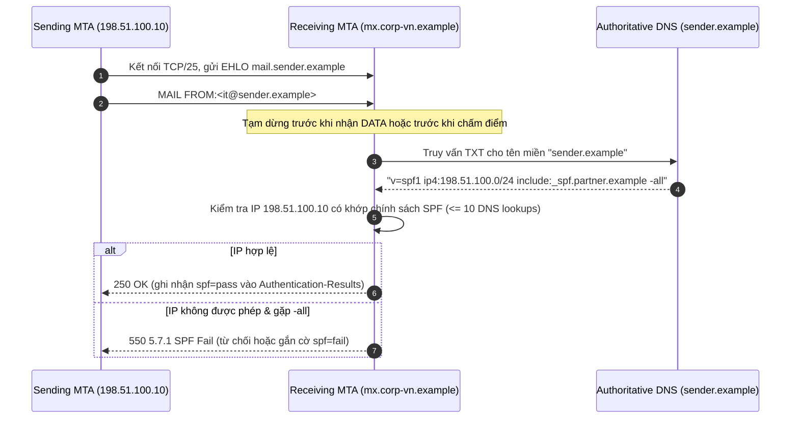
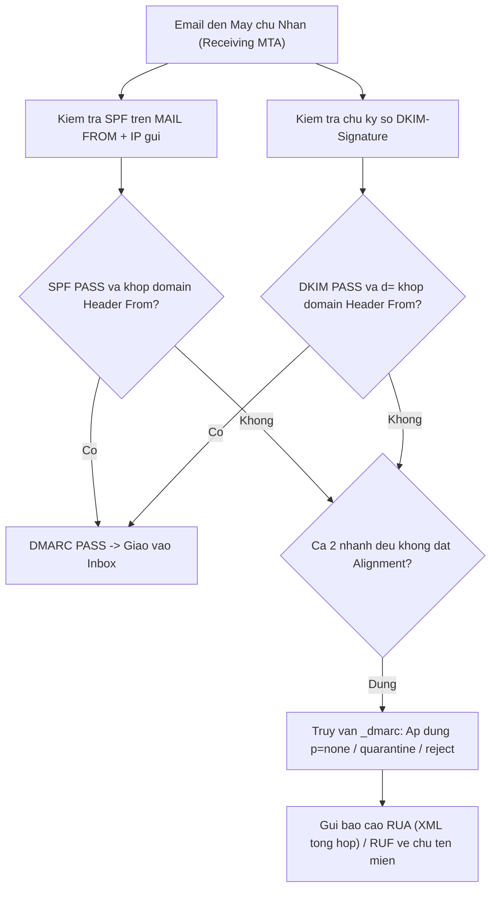
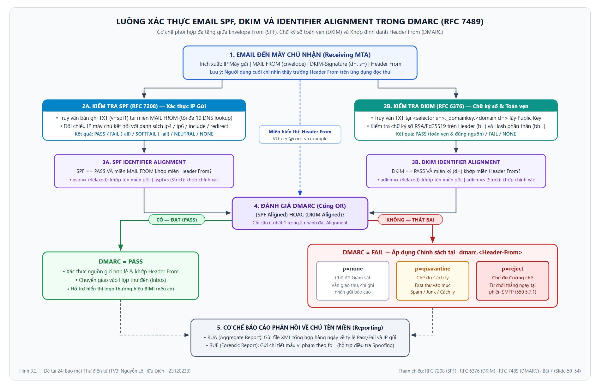
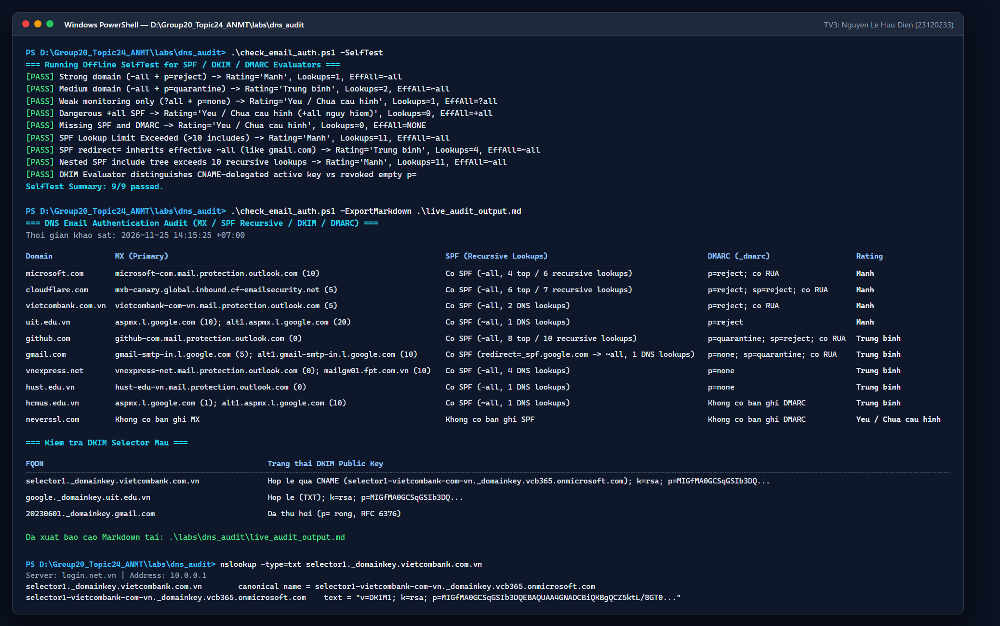

# Chương 3: Cơ chế SPF, DKIM, DMARC trong Xác thực Email

> **Sinh viên thực hiện:** Nguyễn Lê Hữu Điền (`23120233`, *Auth & Simulation Engineer*)  
> **Tài liệu tham chiếu:** `Bai 7 - Web - DHCP - DNS - Email Security.pptx` (S29–S49, S50–S54), `Lab5. Web -DHCP-DNS-Email Security.docx`, `RFC 7208` (SPF), `RFC 6376` (DKIM), `RFC 7489` (DMARC), `RFC 8617` (ARC)

---

## 3.1. Nền tảng DNS Records Phục vụ Xác thực Email

Như đã phân tích ở Chương 1, giao thức truyền tải thư đơn giản (**SMTP — Simple Mail Transfer Protocol**) ra đời khi mạng Internet còn mang tính tin cậy mặc định nên không tích hợp cơ chế xác thực người gửi. Thay vì thay đổi cấu trúc lõi của SMTP, các chuẩn bảo mật email hiện đại khai thác **Hệ thống Phân giải Tên miền (Domain Name System — DNS)** như một cơ sở dữ liệu phân tán công khai để công bố danh sách máy chủ hợp lệ, khóa công khai mật mã và chính sách xử lý vi phạm (*Bai 7*, Slide 37 & 54).

### 3.1.1. Cơ chế phân giải DNS: Truy vấn Đệ quy và Tương tác
Theo *Bai 7* (Slide 30–36), quá trình tra cứu bản ghi xác thực email diễn ra theo mô hình Khách–Chủ (*Client–Server*):
- **Truy vấn đệ quy (*Recursive Query*):** Máy chủ thư nhận (**Receiving MTA**) đóng vai trò trình phân giải (*Resolver*), gửi yêu cầu đến máy chủ DNS nội bộ (*Local DNS Server*) và chờ kết quả cuối cùng (hoặc thông báo lỗi).
- **Truy vấn tương tác (*Iterative Query*):** Nếu bộ nhớ đệm chưa lưu kết quả (hoặc hết thời gian sống *TTL*), Local DNS Server lần lượt hỏi **Root Name Server (.)** → **Top-Level Domain Server** (`.com`, `.vn`) → **Authoritative Name Server** quản lý tên miền mục tiêu để thu về bản ghi chính xác.

### 3.1.2. Các loại Bản ghi Tài nguyên (Resource Records) cho Email

| Loại bản ghi | Tên đầy đủ | Vai trò trong định tuyến & xác thực Email | Ví dụ tra cứu bằng `nslookup` |
| :---: | :--- | :--- | :--- |
| **`MX`** | *Mail Exchanger* | Chỉ định tên miền máy chủ tiếp nhận thư của tổ chức kèm độ ưu tiên (*Preference* — số nhỏ ưu tiên cao hơn). | `nslookup -type=mx uit.edu.vn` |
| **`A` / `AAAA`** | *Address Record* | Ánh xạ tên miền máy chủ thư (từ `MX` hoặc cơ chế `a:` của SPF) sang địa chỉ IPv4 / IPv6 thực tế. | `nslookup -type=a mail.corp-vn.example` |
| **`TXT`** | *Text Record* | Lưu trữ chuỗi văn bản tự do phục vụ công bố chính sách **SPF** (tại tên miền gốc `@`), khóa công khai **DKIM** (tại `<selector>._domainkey`) và chính sách **DMARC** (tại `_dmarc`). | `nslookup -type=txt _dmarc.vietcombank.com.vn` |
| **`CNAME`** | *Canonical Name* | Tạo bí danh chuyển hướng sang tên miền khác; thường dùng để ủy quyền quản lý khóa DKIM sang dịch vụ đám mây (Microsoft 365, SendGrid...). | `nslookup -type=txt selector1._domainkey.vietcombank.com.vn` |
| **`PTR`** | *Pointer Record* | Phân giải ngược (*Reverse DNS*) từ địa chỉ IP sang tên miền nhằm kiểm chứng danh tính máy chủ gửi khi bắt tay SMTP (`EHLO/HELO`). | `nslookup -type=ptr 198.51.100.10` |

*Bảng 3.1: Các loại bản ghi DNS phục vụ định tuyến và xác thực thư điện tử.*

### 3.1.3. Bảo vệ hạ tầng DNS xác thực với DNSSEC
Theo *Bai 7* (Slide 43–49), bản thân giao thức DNS truyền thống sử dụng UDP cổng 53 không có xác thực tích hợp nên dễ bị tấn công **Đầu độc Bộ nhớ đệm DNS (*DNS Cache Poisoning / Kaminsky Attack*)** hoặc **Nghe lén/Sửa đổi trên đường truyền (*Man-in-the-Middle — MITM*)**. Nếu kẻ tấn công giả mạo thành công phản hồi DNS cho bản ghi `TXT` (thay đổi bản ghi `v=spf1` hoặc thay thế khóa công khai DKIM của kẻ tấn công), toàn bộ hệ thống xác thực email phía sau có thể bị qua mặt.

Cơ chế **Bảo mật Mở rộng DNS (*DNSSEC — Domain Name System Security Extensions*)** khắc phục rủi ro này bằng cách bổ sung chữ ký số mật mã khóa công khai (RSA, ECDSA, EdDSA) vào từng vùng DNS thông qua bộ 4 bản ghi chính: **`RRSIG`** (chữ ký số cho tập bản ghi), **`DNSKEY`** (khóa công khai của vùng), **`DS`** (*Delegation Signer* — liên kết chuỗi tin cậy từ vùng cha xuống vùng con), và **`NSEC`/`NSEC3`** (chứng thực từ chối tồn tại). Khi resolver xác thực ngược từ *Root Trust Anchor*, mọi phản hồi `TXT` giả mạo sẽ bị phát hiện và loại bỏ.

---

## 3.2. Cơ chế SPF (Sender Policy Framework — RFC 7208)

**SPF (*Sender Policy Framework*)** là chuẩn xác thực được quy định trong **RFC 7208**, cho phép chủ sở hữu tên miền công bố danh sách các địa chỉ IP hoặc máy chủ gửi thư được ủy quyền thay mặt cho tên miền khai báo tại tầng phong bì SMTP (**`MAIL FROM`** hay **`Envelope From`** / **`Return-Path`**).

### 3.2.1. Luồng hoạt động giữa Máy gửi, DNS và Máy nhận


*Hình 3.1: Luồng kiểm tra xác thực địa chỉ IP máy gửi theo giao thức SPF (RFC 7208).*

### 3.2.2. Cú pháp bản ghi `TXT (v=spf1)`, Cơ chế và Bộ định danh

Một bản ghi SPF hợp lệ bắt buộc bắt đầu bằng tiền tố phiên bản `v=spf1`, theo sau là chuỗi các **cơ chế (*mechanisms*)** và kết thúc bằng chỉ thị xử lý mặc định **`all`**:
```text
v=spf1 ip4:198.51.100.0/24 include:_spf.google.com mx -all
```

| Nhóm thành phần | Cú pháp tiêu biểu | Ý nghĩa kỹ thuật | Có tốn DNS lookup? |
| :--- | :--- | :--- | :---: |
| **Xác định IP trực tiếp** | `ip4:198.51.100.0/24`<br>`ip6:2001:db8::/32` | Cho phép dải IPv4/IPv6 cụ thể gửi thư mà không cần tra cứu thêm tên miền. | Không (`0`) |
| **Tham chiếu bản ghi máy chủ** | `a`, `a:mail.example`<br>`mx`, `mx:sub.example` | Cho phép các IP phân giải được từ bản ghi `A/AAAA` hoặc `MX` của tên miền tương ứng. | Có (`+1` / cơ chế) |
| **Ủy quyền bên thứ ba** | `include:_spf.google.com` | Kế thừa danh sách cho phép từ chính sách SPF của tên miền dịch vụ khác (Microsoft 365, Google Workspace, SendGrid...). | Có (`+1` + chuỗi con) |
| **Chuyển hướng toàn bộ** | `redirect=_spf.google.com` | Bộ điều chỉnh (*modifier*) ủy quyền toàn bộ đánh giá sang tên miền khác (như `gmail.com` chuyển sang `_spf.google.com`) khi không có `all`. | Có (`+1` + chuỗi đích) |
| **Bộ định danh (*Qualifiers*)** | **`+`** (*Pass* — mặc định)<br>**`-`** (*Fail / HardFail*)<br>**`~`** (*SoftFail*)<br>**`?`** (*Neutral*) | Gắn trước cơ chế hoặc `all`: **`-all`** yêu cầu từ chối mọi IP ngoài danh sách; **`~all`** đánh dấu nghi ngờ nhưng vẫn tiếp nhận để lọc tiếp; **`+all`** cho phép *mọi IP trên Internet* (lỗi cấu hình nghiêm trọng). | Không |

*Bảng 3.2: Giải thích các cơ chế, bộ điều chỉnh và bộ định danh (Qualifiers) trong bản ghi SPF (RFC 7208).*

Máy nhận có thể trả về một trong 7 trạng thái kết quả chuẩn RFC 7208: **`Pass`** (hợp lệ), **`Fail`** (vi phạm `-all`), **`SoftFail`** (nghi ngờ `~all`), **`Neutral`** (`?all`), **`None`** (không có bản ghi SPF), **`TempError`** (lỗi mạng/DNS tạm thời) và **`PermError`** (lỗi cú pháp, có nhiều hơn 1 bản ghi `v=spf1`, hoặc vượt quá 10 DNS lookup).

### 3.2.3. Ba hạn chế cốt lõi của SPF
1. **Không bảo vệ trường `Header From` (Địa chỉ người dùng nhìn thấy):** SPF chỉ xác thực tên miền trong lệnh `MAIL FROM` ở tầng phong bì SMTP (*Envelope From*), hoàn toàn bỏ qua tiêu đề `From:` bên trong nội dung thư. Kẻ tấn công có thể đăng ký miền `attacker.example`, cấu hình SPF hợp lệ cho chính IP của hắn (`SPF=PASS`) nhưng vẫn điền `From: "Giám đốc" <ceo@corp-vn.example>` để lừa nạn nhân.
2. **Bị gãy khi chuyển tiếp email (*Email Forwarding*):** Khi hộp thư trung gian tự động chuyển tiếp (*auto-forward*) thư sang một địa chỉ khác, địa chỉ IP kết nối tới máy chủ nhận cuối là IP của máy chủ chuyển tiếp chứ không phải IP của người gửi ban đầu, khiến kiểm tra SPF thất bại (khắc phục bằng kỹ thuật viết lại địa chỉ trả về **SRS — *Sender Rewriting Scheme*** hoặc kết hợp DKIM/ARC).
3. **Giới hạn tối đa 10 lần tra cứu DNS (*10-DNS-Lookup Limit*):** Theo Mục 4.6.4 của RFC 7208, tổng số cơ chế cần phân giải DNS (`include`, `a`, `mx`, `ptr`, `exists`, `redirect`) trong toàn bộ cây đệ quy không được vượt quá **10** (nhằm ngăn chặn kẻ tấn công lợi dụng bản ghi SPF chứa chuỗi lồng nhau gây tấn công khuếch đại từ chối dịch vụ vào hạ tầng DNS). Khảo sát thực tế ở Mục 3.5 cho thấy `github.com` hiện đã chạm đúng ngưỡng `10 / 10` lookup; trong khi `gmail.com` sử dụng kỹ thuật làm phẳng (*SPF Flattening*) trong `_spf.google.com` để giảm xuống chỉ còn `1` lookup.

---

## 3.3. Cơ chế DKIM (DomainKeys Identified Mail — RFC 6376)

**DKIM (*DomainKeys Identified Mail*)** được chuẩn hóa tại **RFC 6376**, sử dụng **mật mã khóa bất đối xứng (*Asymmetric Cryptography*)** để gắn chữ ký số trực tiếp vào tiêu đề email, qua đó giải quyết hai mục tiêu trong bộ ba CIA Triad: **Xác thực nguồn gốc (*Authentication*)** và **Bảo vệ tính toàn vẹn (*Integrity*)** của thông điệp trên đường truyền.

### 3.3.1. Quy trình Ký số và Xác minh Chữ ký
1. **Chuẩn bị và Khởi tạo khóa:** Quản trị viên tên miền tạo cặp khóa **RSA** (khuyến nghị độ dài tối thiểu `2048-bit`) hoặc **Ed25519**, giữ **Khóa bí mật (*Private Key*)** tại máy chủ gửi (Sending MTA) và công bố **Khóa công khai (*Public Key*)** qua bản ghi DNS `TXT` tại địa chỉ `<selector>._domainkey.<domain>`.
2. **Chuẩn hóa (*Canonicalization*) & Ký ở phía Gửi:** Vì các máy chủ trung gian có thể thêm khoảng trắng hoặc gập dòng tiêu đề, DKIM hỗ trợ hai chế độ chuẩn hóa **`simple`** (giữ nguyên từng byte) và **`relaxed`** (bỏ qua khác biệt khoảng trắng thừa/chữ hoa–thường ở tên tiêu đề). Máy gửi băm phần thân thư để tạo giá trị `bh=`, sau đó ký số lên chuỗi băm kết hợp các tiêu đề trọng yếu (`From`, `To`, `Subject`, `Date`...) và chèn kết quả vào trường tiêu đề `DKIM-Signature:`.
3. **Xác minh ở phía Nhận:** Receiving MTA đọc tên miền ký (`d=`) và bộ chọn khóa (`s=`), truy vấn DNS tại `<s>._domainkey.<d>` lấy Public Key, tính lại giá trị băm phần thân đối chiếu với `bh=` và giải mã chữ ký `b=`. Nếu khớp hoàn toàn → **`dkim=pass`**; nếu nội dung hoặc tiêu đề bị sửa đổi giữa đường → **`dkim=fail`**.

### 3.3.2. Giải phẫu Chi tiết một Tiêu đề `DKIM-Signature` và Khóa Công khai DNS

Dưới đây là cấu trúc một tiêu đề `DKIM-Signature` chuẩn hóa mô phỏng theo chuẩn RFC 6376 (sử dụng tên miền giả định `.example` theo RFC 2606):

```text
DKIM-Signature: v=1; a=rsa-sha256; c=relaxed/relaxed;
    d=corp-vn.example; s=mail2026; t=1795570500;
    h=from:to:subject:date:message-id;
    bh=47DEQpj8HBSa+/TImW+5JCeuQeRkm5NMpJWZG3hSuFU=;
    b=K9pX2vR7mQ8sT1nL4wZ6yB0cD3fG5hJ7kM9pQ2rS4tU6vW8xY0zA2bC4dE6f...
```

| Thẻ (*Tag*) | Tên gọi & Giá trị mẫu | Vai trò kỹ thuật theo RFC 6376 |
| :---: | :--- | :--- |
| **`v=`** | `1` (Phiên bản) | Xác định phiên bản giao thức DKIM (luôn là `1`). |
| **`a=`** | `rsa-sha256` (Thuật toán) | Thuật toán ký và băm sử dụng (`rsa-sha256` phổ biến nhất, hoặc `ed25519-sha256`). |
| **`c=`** | `relaxed/relaxed` (Chuẩn hóa) | Quy tắc chuẩn hóa lần lượt cho `Header/Body` nhằm chịu lỗi khoảng trắng khi qua relay trung gian. |
| **`d=`** | `corp-vn.example` (Tên miền ký) | Tên miền chịu trách nhiệm ký số (*Signing Domain*) dùng để ghép địa chỉ tra cứu DNS. |
| **`s=`** | `mail2026` (*Selector*) | Bộ chọn khóa giúp một tên miền duy trì nhiều cặp khóa song song (phân tách hệ thống hoặc xoay vòng khóa định kỳ). |
| **`t=`** | `1795570500` (Dấu thời gian) | Thời điểm tạo chữ ký (Unix timestamp), hỗ trợ kiểm soát thời hạn chữ ký (`x=`). |
| **`h=`** | `from:to:subject:date:message-id` | Danh sách các tiêu đề được đưa vào tính chữ ký. Trường `from` luôn **bắt buộc** có mặt. |
| **`bh=`** | `47DEQpj8HBSa...=` (*Body Hash*) | Giá trị băm SHA-256 (mã hóa Base64) của toàn bộ phần thân email sau khi chuẩn hóa. |
| **`b=`** | `K9pX2vR7mQ8s...` (*Signature Data*) | Chữ ký số thực sự được tạo bởi Private Key của máy gửi trên các header trong `h=` và bản thân thẻ `DKIM-Signature`. |

*Bảng 3.3: Phân tích chi tiết từng thành phần thẻ (Tag) trong tiêu đề `DKIM-Signature`.*

Khi kiểm tra thực tế trên DNS (chi tiết tại Mục 3.5 và [audit_results.md](../labs/dns_audit/audit_results.md)), hệ thống cho thấy ba cách công bố khóa công khai phổ biến:
- **Ủy quyền qua `CNAME`:** `selector1._domainkey.vietcombank.com.vn` trỏ sang `selector1-vietcombank-com-vn._domainkey.vcb365.onmicrosoft.com` trả về chuỗi `"v=DKIM1; k=rsa; p=MIGfMA0GCSqGSIb3DQ..."` (Microsoft 365 tự động xoay vòng khóa).
- **Khai báo `TXT` trực tiếp:** `google._domainkey.uit.edu.vn` trả về trực tiếp chuỗi khóa công khai RSA `v=DKIM1; k=rsa; p=...`.
- **Thu hồi khóa theo RFC 6376:** `20230601._domainkey.gmail.com` trả về `"v=DKIM1; k=rsa; p="` (giá trị `p=` rỗng báo hiệu khóa đã bị vô hiệu hóa khi xoay vòng selector).

### 3.3.3. Ưu điểm và Hạn chế khi DKIM đứng riêng
- **Ưu điểm vượt trội:** Chữ ký DKIM gắn liền vào phần header của thông điệp nên **vẫn giữ nguyên tính hợp lệ khi email bị chuyển tiếp (*Email Forwarding*)**, miễn là máy chủ trung gian không sửa đổi nội dung phần thân hoặc các tiêu đề liệt kê trong `h=`.
- **Hạn chế:** (1) DKIM đứng độc lập **không bắt buộc tên miền ký `d=` phải trùng khớp với địa chỉ hiển thị `Header From`** (kẻ tấn công có thể dùng miền rác `evil.example` để ký hợp lệ `dkim=pass` cho một email giả mạo `From: ceo@corp-vn.example`); (2) DKIM không định nghĩa chính sách chặn thư hay cơ chế gửi báo cáo phản hồi về chủ sở hữu tên miền khi phát hiện giả mạo.

---

## 3.4. Cơ chế DMARC (RFC 7489) và Các Chuẩn Mở rộng (ARC, BIMI)

**DMARC (*Domain-based Message Authentication, Reporting, and Conformance* — RFC 7489)** ra đời để hợp nhất sức mạnh của SPF và DKIM, bổ sung mảnh ghép còn thiếu quan trọng nhất: **Kiểm tra Khớp định danh (*Identifier Alignment*)** gắn trực tiếp với trường **`Header From`**, kèm theo **Chính sách xử lý thống nhất** và **Cơ chế báo cáo**.

### 3.4.1. Cơ chế Cốt lõi: Identifier Alignment (Khớp định danh)

DMARC chỉ kết luận **`dmarc=pass`** khi thỏa mãn ít nhất một trong hai điều kiện sau:
1. **SPF Alignment:** Kiểm tra SPF trả về `pass` **VÀ** tên miền trong `MAIL FROM` (Envelope) khớp với tên miền trong `Header From`.
2. **DKIM Alignment:** Kiểm tra DKIM trả về `pass` **VÀ** tên miền ký `d=` trong `DKIM-Signature` khớp với tên miền trong `Header From`.

RFC 7489 quy định hai mức độ khắt khe cho việc so khớp thông qua thẻ **`aspf=`** (cho SPF) và **`adkim=`** (cho DKIM):
- **Chế độ Nới lỏng (*Relaxed* — `r`, mặc định):** Chỉ yêu cầu hai tên miền có **cùng Tên miền Gốc đăng ký (*Organizational / Registrable Domain*)** (ví dụ: `mail.corp-vn.example` khớp với `corp-vn.example`).
- **Chế độ Nghiêm ngặt (*Strict* — `s`):** Bắt buộc hai chuỗi tên miền phải **trùng khớp chính xác 100%** từng cấp subdomain.

| Tình huống thực tế | `Header From` | `MAIL FROM` (SPF) | `DKIM d=` (DKIM) | Kết quả DMARC (`r` vs `s`) | Giải thích kỹ thuật |
| :--- | :--- | :--- | :--- | :---: | :--- |
| **1. Khớp hoàn toàn** | `corp-vn.example` | `corp-vn.example` (`PASS`) | `corp-vn.example` (`PASS`) | **PASS** (`r` & `s`) | Cả SPF Alignment và DKIM Alignment đều đạt chuẩn tuyệt đối. |
| **2. Gửi từ Subdomain** | `corp-vn.example` | `bounce.corp-vn.example` (`PASS`) | Không có (`NONE`) | **`r`: PASS** / **`s`: FAIL** | Cùng Organizational Domain `corp-vn.example` nhưng khác subdomain. |
| **3. Spoofing `From` trực tiếp** | `vcb-bank.example` | `promo-99.example` (`PASS`*) | Không có (`NONE`) | **FAIL** (`r` & `s`) | Kẻ tấn công vượt qua SPF trên miền của hắn nhưng trượt Alignment với `Header From` (mô phỏng ở *Mẫu 2* & *Mẫu 3*). |
| **4. Email bị chuyển tiếp** | `corp-vn.example` | `forwarder.example` (`FAIL`) | `corp-vn.example` (`PASS`) | **PASS** (`r` & `s`) | SPF bị gãy qua máy chủ trung gian nhưng DKIM vẫn còn chữ ký khớp `Header From` nên cứu được DMARC. |
| **5. Kẻ tấn công dùng miền Lookalike** | `xn--micrsoft-qbh.example` | `xn--micrsoft-qbh.example` (`PASS`) | `xn--micrsoft-qbh.example` (`PASS`) | **PASS** *(Cảnh báo!)* | Nếu hacker tự đăng ký miền giả mạo gần giống (`micrоsoft.example` dùng chữ `о` Cyrillic `U+043E`) và cấu hình đầy đủ, DMARC vẫn PASS — minh chứng cần kết hợp lọc nội dung & nhận thức người dùng (*Mẫu 4*). |

*Bảng 3.4: Đối chiếu các tình huống đánh giá Identifier Alignment giữa chế độ Relaxed (`r`) và Strict (`s`).*

### 3.4.2. Luồng đánh giá Tổng hợp SPF – DKIM – DMARC


*Hình 3.2 (Mermaid) & sơ đồ trực quan độ phân giải cao bên dưới minh họa luồng phối hợp hoàn chỉnh của bộ ba xác thực.*



### 3.4.3. Chính sách Xử lý (`_dmarc`), Cơ chế Báo cáo và Lộ trình Triển khai

Chủ sở hữu tên miền công bố chính sách tại bản ghi `TXT` có tên `_dmarc.<domain>`, ví dụ:
```text
v=DMARC1; p=reject; sp=reject; adkim=r; aspf=r; pct=100; rua=mailto:dmarc-rua@corp-vn.example; ruf=mailto:dmarc-ruf@corp-vn.example; fo=1
```
- **Thẻ chính sách (`p=`, `sp=`, `pct=`):**
  - `p=none`: Chỉ giám sát và gửi báo cáo, **không chặn** email vi phạm (dùng trong giai đoạn khảo sát ban đầu).
  - `p=quarantine`: Đưa email trượt DMARC vào thư mục cách ly / thư rác (*Spam / Junk*).
  - `p=reject`: **Từ chối nhận hoàn toàn** ngay tại phiên giao dịch SMTP (`550 5.7.1`) — mức bảo vệ cao nhất chống Email Spoofing trực tiếp.
  - `sp=`: Chính sách áp dụng riêng cho các tên miền con (*Subdomain*) để chặn kẻ tấn công giả mạo địa chỉ dạng `pay@sub.corp-vn.example`.
  - `pct=`: Tỷ lệ phần trăm (`1–100`) lưu lượng vi phạm bị áp dụng chính sách `quarantine`/`reject`.
- **Cơ chế báo cáo (`RUA` và `RUF`):**
  - **`RUA` (*Aggregate Reports*):** Máy chủ nhận trên toàn thế giới (Gmail, Outlook, Yahoo...) định kỳ mỗi ngày (thường `ri=86400` giây) nén gửi tệp **XML** thống kê tổng hợp về địa chỉ `rua=`. Nhờ XML này, quản trị viên biết chính xác dải IP nào đang gửi thư hợp lệ (CRM, phần mềm kế toán, máy chủ web) và dải IP nào đang mạo danh tên miền công ty:
    ```xml
    <record>
      <row>
        <source_ip>203.0.113.88</source_ip>
        <count>42</count>
        <policy_evaluated>
          <disposition>reject</disposition>
          <dkim>fail</dkim>
          <spf>fail</spf>
        </policy_evaluated>
      </row>
    </record>
    ```
  - **`RUF` (*Forensic / Failure Reports*):** Gửi bản sao chi tiết (hoặc phần header) của từng email vi phạm theo thời gian thực dựa trên tùy chọn `fo=` (`fo=1` kích hoạt khi SPF hoặc DKIM bất kỳ gặp lỗi).
- **Lộ trình 4 bước triển khai an toàn ngoài thực tế:** (1) Thiết lập `v=DMARC1; p=none; rua=...` để thu thập dữ liệu lưu lượng thực tế → (2) Rà soát báo cáo RUA để cấp quyền SPF/DKIM cho 100% dịch vụ gửi hợp pháp còn thiếu → (3) Nâng cấp lên `p=quarantine` với `pct=10` rồi tăng dần lên `pct=100` → (4) Chốt chính sách `p=reject` để triệt tiêu nguy cơ giả mạo tên miền chính thức.

### 3.4.4. Các chuẩn Mở rộng: ARC và BIMI
- **ARC (*Authenticated Received Chain* — RFC 8617):** Khi email đi qua danh sách gửi thư (*Mailing List*) hoặc máy chủ chuyển tiếp có chỉnh sửa nhẹ nội dung (thêm footer `[Danh sách nhóm]`), chữ ký DKIM gốc có thể bị hỏng và SPF bị gãy. ARC giải quyết bằng bộ 3 tiêu đề chữ ký chuỗi qua từng chặng (`ARC-Authentication-Results`, `ARC-Message-Signature`, `ARC-Seal`), cho phép máy nhận cuối tin tưởng trạng thái xác thực ban đầu do các máy chủ trung gian uy tín xác nhận.
- **BIMI (*Brand Indicators for Message Identification*):** Cho phép hiển thị **logo chính thức của doanh nghiệp** ngay cạnh tên người gửi trong hộp thư đến (như Gmail, Yahoo Mail) **chỉ khi** tên miền đã đạt chuẩn DMARC ở mức cưỡng chế (`p=quarantine` với `pct=100` hoặc `p=reject`) và thường đi kèm chứng chỉ xác thực thương hiệu **VMC (*Verified Mark Certificate*)**. Điều này biến bảo mật kỹ thuật thành tín hiệu nhận diện trực quan giúp người dùng phổ thông dễ dàng phân biệt thư chính chủ.

---

## 3.5. So sánh Tổng hợp & Kết quả Khảo sát Cấu hình DNS Thực tế

### 3.5.1. Bảng So sánh Vai trò Bổ trợ của SPF, DKIM và DMARC

| Tiêu chí so sánh | SPF (`RFC 7208`) | DKIM (`RFC 6376`) | DMARC (`RFC 7489`) |
| :--- | :--- | :--- | :--- |
| **Đối tượng xác thực** | Địa chỉ IP máy gửi đối chiếu với miền `MAIL FROM` | Chữ ký số gắn trên Header (`h=`) và Body (`bh=`) | Sự trùng khớp (*Alignment*) với miền hiển thị **`Header From`** |
| **Cơ chế kỹ thuật & DNS** | Danh sách IP/tên miền trong bản ghi `TXT` (`v=spf1`) | Mật mã khóa bất đối xứng (`RSA`/`Ed25519`) tại `<s>._domainkey` | Hợp nhất SPF + DKIM + luật tại `_dmarc.<domain>` |
| **Bảo vệ trường `Header From`** | **Không** | **Không** (chỉ chứng minh miền `d=` đã ký) | **Có** (chốt chặn trực tiếp chống Email Spoofing) |
| **Bảo vệ tính toàn vẹn** | **Không** | **Có** (phát hiện mọi sửa đổi nội dung/tiêu đề) | Kế thừa từ DKIM |
| **Sống sót qua Forwarding** | Dễ gãy (IP đổi sang máy chuyển tiếp) | **Có** (nếu không sửa nội dung/tiêu đề ký) | **Có** (chỉ cần DKIM còn Alignment) |
| **Chính sách chặn & Báo cáo** | Không có báo cáo; chỉ gợi ý qua `-all`/`~all` | Không quy định hành động chặn hay báo cáo | **Có** (`p=none/quarantine/reject` + báo cáo XML `RUA/RUF`) |

*Bảng 3.5: Tổng hợp so sánh đặc điểm kỹ thuật và vai trò bổ trợ của SPF, DKIM và DMARC.*

### 3.5.2. Kết quả Khảo sát Thực nghiệm Cấu hình DNS trên 10 Tên miền Thực tế

Để kiểm chứng mức độ áp dụng ngoài thực tế, nhóm đã phát triển công cụ PowerShell tự động [check_email_auth.ps1](../labs/dns_audit/check_email_auth.ps1) (tích hợp phân giải đệ quy chuỗi `include:` / `redirect=` để tính chính xác giới hạn 10 DNS lookup của RFC 7208 và truy vấn khóa công khai DKIM selector). Kết quả chạy trực tiếp trên mạng Internet vào ngày **`25/11/2026` (`14:15 +07:00`)** được ghi nhận chi tiết tại [audit_results.md](../labs/dns_audit/audit_results.md) và tổng hợp ở *Bảng 3.6*:

| STT | Tên miền | Bản ghi MX chính | SPF (`v=spf1`), cơ chế cuối & số lookup đệ quy | DMARC (`_dmarc`) | Đánh giá |
| :-: | :--- | :--- | :--- | :--- | :---: |
| 1 | `microsoft.com` | `microsoft-com.mail.protection.outlook.com (10)` | `-all` (`4` top / `6` recursive lookups) | `p=reject; pct=100; rua=...; ruf=...; fo=1` | **Mạnh** |
| 2 | `cloudflare.com` | `mxb-canary.global.inbound.cf-emailsecurity.net (5)` | `-all` (`6` top / `7` recursive lookups) | `p=reject; sp=reject; adkim=r; aspf=r; pct=100; rua=...` | **Mạnh** |
| 3 | `vietcombank.com.vn` | `vietcombank-com-vn.mail.protection.outlook.com (5)` | `~all` (`2` recursive lookups) | `p=reject; pct=100; rua=mailto:infosec@...; ruf=...; fo=1` | **Mạnh** |
| 4 | `uit.edu.vn` | `aspmx.l.google.com (10); alt1.aspmx.l.google.com (20)` | `~all` (`1` recursive lookup) | `p=reject` | **Mạnh** |
| 5 | `github.com` | `github-com.mail.protection.outlook.com (0)` | `~all` (`8` top / `10` recursive lookups) | `p=quarantine; sp=reject; pct=100; rua=...; ruf=...` | **Trung bình** |
| 6 | `gmail.com` | `gmail-smtp-in.l.google.com (5); alt1... (10)` | `redirect=_spf.google.com` → `~all` (`1` lookup) | `p=none; sp=quarantine; rua=mailto:mailauth-reports@...` | **Trung bình** |
| 7 | `vnexpress.net` | `vnexpress-net.mail.protection.outlook.com (0); ...` | `-all` (`4` recursive lookups) | `p=none;` | **Trung bình** |
| 8 | `hust.edu.vn` | `hust-edu-vn.mail.protection.outlook.com (0)` | `-all` (`1` recursive lookup) | `p=none;` | **Trung bình** |
| 9 | `hcmus.edu.vn` | `aspmx.l.google.com (1); alt1.aspmx.l.google.com (10)` | `~all` (`1` recursive lookup) | *Không có bản ghi `_dmarc`* | **Trung bình** |
| 10 | `neverssl.com` | *Không có bản ghi MX* | *Không có bản ghi SPF* | *Không có bản ghi DMARC* | **Yếu / Chưa cấu hình** |

*Bảng 3.6: Kết quả thực nghiệm kiểm tra bản ghi MX, SPF (đệ quy) và DMARC trên 10 tên miền thực tế ngày 25/11/2026.*



### 3.5.3. Phân tích Chuyên sâu từ Kết quả Thực nghiệm
1. **Nhóm Ngân hàng và Tập đoàn Công nghệ lớn đạt mức bảo vệ cao (`Mạnh`):** `microsoft.com`, `cloudflare.com` và `vietcombank.com.vn` đều khóa chặt DMARC ở chế độ `p=reject; pct=100` kèm địa chỉ nhận báo cáo `rua`/`ruf`, sẵn sàng ngăn chặn triệt để email giả mạo `Header From` ngay tại cổng tiếp nhận của đối tác. Ngoài ra, truy vấn DKIM của `vietcombank.com.vn` (`selector1._domainkey.vietcombank.com.vn`) minh họa rõ mô hình **ủy quyền CNAME** sang Microsoft 365 giúp tự động hóa việc xoay vòng khóa.
2. **Khoảng trống bảo vệ ở nhóm Báo chí và Giáo dục (`Trung bình`):** Trong 3 trường đại học được khảo sát, chỉ `uit.edu.vn` đã cưỡng chế hoàn toàn `p=reject` (kèm khóa RSA hợp lệ tại `google._domainkey.uit.edu.vn`). Ngược lại, `hust.edu.vn` và báo điện tử `vnexpress.net` dù đã cấu hình SPF `-all` rất chặt nhưng DMARC mới dừng ở `p=none` (chỉ giám sát, không chặn) và chưa khai báo `rua=`. Đặc biệt, `hcmus.edu.vn` đã bật SPF `~all` của Google Workspace nhưng **vẫn thiếu hoàn toàn bản ghi `_dmarc`**. Kiến nghị lộ trình khắc phục cho các đơn vị này là thiết lập ngay `v=DMARC1; p=none; rua=...` để rà soát hệ thống gửi nội bộ, sau đó tiến dần lên `p=quarantine` và `p=reject`.
3. **Các bài học kỹ thuật đặc thù về SPF (`github.com` và `gmail.com`):**
   - `github.com` sử dụng đồng thời 8 dịch vụ gửi thư (`include:` Outlook, Google, Zendesk, Salesforce, Mailchimp, Marketo, SendGrid...) khiến tổng số truy vấn đệ quy đạt đúng **`10 / 10` lookup** (tính cả cơ chế lồng `exists:` trong `_spf.salesforce.com` và `include:ab.sendgrid.net` trong `sendgrid.net`). Nếu bổ sung thêm dịch vụ mà không gom/làm phẳng IP, bản ghi sẽ vượt giới hạn RFC 7208 và gây lỗi `PermError`.
   - `gmail.com` sử dụng từ khóa `redirect=_spf.google.com` thay cho cơ chế `all` trực tiếp (nếu công cụ kiểm tra không phân giải đệ quy sẽ đánh giá nhầm là thiếu chính sách) và đặt `p=none` cho tên miền gốc nhằm tránh làm gián đoạn thư của hàng tỷ người dùng cá nhân khi chuyển tiếp qua các máy chủ trung gian cũ.
4. **Rủi ro với tên miền chưa cấu hình (`neverssl.com`):** Thiếu cả SPF lẫn DMARC khiến tên miền không có cơ chế tự vệ hay báo cáo khi bị kẻ xấu mạo danh làm địa chỉ gửi (*Email Spoofing*), buộc hệ thống nhận phải phụ thuộc hoàn toàn vào bộ lọc nội dung và nhận thức người dùng — chủ đề được giải quyết tiếp trong **Chương 4 (Defense in Depth)**.
