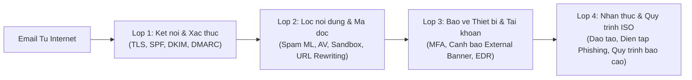

# Chương 4: Đề xuất Giải pháp Tổng thể Defense in Depth

> **Phụ trách:** Thành viên 1 (Trưởng nhóm)  
> **Tài liệu tham chiếu:** `Bai 7` (S53–S56), `Bài 8` (S32–S38), `L1` (S14–S19, S29, S32), `Tieu chuan ISO 27000.pptx` (S6–S46, S58–S69)

---

## 4.1. Kiến trúc Phòng thủ Đa lớp (Defense in Depth) cho Email

Không có một công cụ đơn lẻ nào đủ sức chặn đứng 100% các cuộc tấn công qua thư điện tử: lọc nội dung có thể sót các cuộc tấn công BEC không chứa liên kết độc; ngược lại, SPF/DKIM/DMARC không chặn được email gửi từ tên miền giả mạo mới đăng ký (`Lookalike Domain`). Do đó, giải pháp đề xuất phải tuân theo nguyên lý **Defense in Depth** (*L1*, Slide 19; *Bai 7*, Slide 50), phối hợp chặt chẽ **3 trụ cột**: Công nghệ lọc nội dung/mã độc — Chuẩn xác thực & mã hóa — Con người & Quản trị theo tiêu chuẩn quốc tế.

*Hình 4.1: Mô hình phòng thủ đa lớp (Defense in Depth) cho hệ thống thư điện tử.*

---

## 4.2. Trụ cột 1: Bộ lọc Thư rác & Chống Mã độc

Triển khai tại lớp **Secure Email Gateway (SEG)** và máy trạm (*Bai 7*, Slide 55; *Bài 8*, Slide 32–38):
1. **Bộ lọc thư rác thống kê & Machine Learning:** Kết hợp bộ lọc Bayesian (tính xác suất từ khóa đặc trưng) với mô hình học máy/NLP phân tích ngữ cảnh, hành vi bất thường và độ uy tín địa chỉ IP gửi (*RBL/Reputation*).
2. **Quét chữ ký (*Signature*) & Phân tích Heuristic:** Đối chiếu mã băm và mẫu nhị phân của tệp đính kèm với cơ sở dữ liệu mã độc, đồng thời dùng phân tích Heuristic phát hiện biến thể mới (*zero-day*) hoặc tệp chứa Macro đáng ngờ.
3. **Sandboxing tệp đính kèm:** Cách ly các tệp thực thi, tệp nén hoặc tài liệu Office chứa Macro vào máy ảo an toàn để theo dõi hành vi gọi API, chỉnh sửa Registry và kết nối mạng trước khi cho vào hộp thư người nhận.
4. **URL Rewriting & Time-of-Click Protection:** Viết lại liên kết trong email đi qua bộ kiểm tra an toàn tại thời điểm người dùng thực sự nhấp chuột, chống kỹ thuật chuyển hướng chậm sau khi email đã lọt qua Gateway.
5. **Tự động gắn nhãn cảnh báo (`[EXTERNAL]`):** Chèn biểu ngữ cảnh báo ở đầu mọi email đến từ bên ngoài tổ chức để giảm hiệu quả của Display Name Spoofing/BEC.

---

## 4.3. Trụ cột 2: Xác thực Người gửi & Bảo mật Truyền tải / Nội dung

- **Xác thực người gửi đồng bộ (`SPF + DKIM + DMARC`):** Cấp phát khóa DKIM riêng cho từng hệ thống gửi, kiểm soát giới hạn 10 DNS lookup của SPF, và thiết lập lộ trình DMARC nâng dần từ `p=none` → `p=quarantine` → `p=reject` để chặn triệt để giả mạo tên miền tổ chức.
- **Bảo mật kênh truyền (`SMTPS / STARTTLS + MTA-STS / DANE`):** Mã hóa đường truyền giữa các MTA bằng TLS nhằm chống nghe lén và sửa đổi gói tin, kết hợp `MTA-STS` hoặc `DANE` (dựa trên DNSSEC) để ngăn chặn tấn công hạ cấp (*downgrade attack*).
- **Bảo mật & Toàn vẹn đầu-cuối (`PGP / S/MIME`):** Áp dụng cho các giao dịch tài chính, pháp lý hoặc thông tin nội bộ tuyệt mật (*Bai 7*, Slide 56). Tuy nhiên cần có giải pháp quản lý chứng thư số / khóa công khai tập trung để khắc phục nhược điểm phức tạp khi triển khai đại trà.

---

## 4.4. Trụ cột 3: Nâng cao Nhận thức Người dùng & Quản trị theo ISO/IEC 27002 & 27005

Theo *L1* (Slide 15, 29, 32), **Security Awareness** là tuyến phòng thủ quyết định trước các đòn tâm lý *Social Engineering*. Để giải pháp vận hành bền vững, tổ chức cần ánh xạ vào bộ tiêu chuẩn **ISO/IEC 27002:2022** và **ISO/IEC 27005:2022** (*Tieu chuan ISO 27000.pptx*):

| Nhóm kiểm soát (`ISO/IEC 27002:2022`) | Biện pháp áp dụng cụ thể cho Bảo mật Email |
| :--- | :--- |
| **Technological Controls** *(Kiểm soát Công nghệ)* | Bật MFA/FIDO2 cho mọi tài khoản email (giảm thiệt hại ngay cả khi lộ mật khẩu); triển khai SEG, IDS/IPS, lưu và phân tích log truy cập bất thường, cập nhật bản vá Mail Server & Mail Client định kỳ. |
| **People Controls** *(Kiểm soát Con người)* | Tổ chức đào tạo nhận thức an ninh định kỳ theo vai trò (nhấn mạnh bộ phận Kế toán/Nhân sự trước BEC); triển khai **diễn tập Phishing giả lập** hàng quý để đo tỷ lệ bấm link; xây dựng văn hóa **khuyến khích báo cáo sớm** thay vì chỉ trừng phạt khi bấm nhầm. |
| **Organizational Controls** *(Kiểm soát Tổ chức)* | Ban hành chính sách xác minh đa kênh (gọi điện trực tiếp xác nhận trước mọi lệnh chuyển tiền hoặc đổi tài khoản nhận qua email); thiết lập quy trình phản ứng nhanh sự cố Phishing (nút *Report Phishing* giúp SOC thu hồi email hàng loạt trên toàn hệ thống). |

Kết hợp quy trình quản lý rủi ro **ISO/IEC 27005:2022** (Slide 58–69): thực hiện chu trình lặp **Nhận dạng rủi ro email** → **Phân tích khả năng xảy ra & hậu quả** (ví dụ nguy cơ BEC ở phòng Kế toán) → **Lựa chọn biện pháp xử lý** → **Giám sát và cải tiến liên tục**.

---

## 4.5. Bảng Checklist Thực hành An toàn Email

| Đối tượng | Hạng mục kiểm tra bắt buộc |
| :--- | :--- |
| **Quản trị viên IT** | `[ ]` Cấu hình đầy đủ SPF (`-all` hoặc `~all`), DKIM (≥ 2048-bit), DMARC (`p=reject`). `[ ]` Bắt buộc TLS cho kết nối SMTP & kích hoạt MFA cho 100% tài khoản. `[ ]` Chặn tệp đính kèm thực thi (`.exe`, `.scr`, `.vbs`, `.js`, `.iso`) và cảnh báo Macro tại Gateway. `[ ]` Bật banner `[EXTERNAL]` và nút *Report Phishing* trong Mail Client. |
| **Người dùng cuối** | `[ ]` Đối chiếu địa chỉ thật (`From`, `Reply-To`) trước mọi email mang tính khẩn cấp/tài chính. `[ ]` Luôn rê chuột xem URL đích thực tế trước khi nhấp; không nhập mật khẩu qua link trong mail. `[ ]` Không mở tệp đuôi kép hoặc bấm *Enable Macros* trên tài liệu gửi từ bên ngoài. `[ ]` Xác nhận qua điện thoại/kênh độc lập khi nhận yêu cầu chuyển khoản từ lãnh đạo/đối tác. |

---

## Checklist Hoàn thiện Chương 4 (TV1)

- [ ] **[TODO (TV1)]:** Xuất sơ đồ *Hình 4.1* ra file ảnh `report/assets/ch4_defense_in_depth.png` (có thể vẽ chi tiết hơn bằng Draw.io thể hiện rõ 4 lớp và vị trí từng giao thức).
- [ ] **[TODO (TV1)]:** Bổ sung một bảng ví dụ **Đánh giá rủi ro Email theo ISO/IEC 27005:2022** (chọn 3 rủi ro tiêu biểu: BEC phòng Kế toán, Malware đính kèm, Rò rỉ tài khoản nhân viên → chấm Khả năng xảy ra × Hậu quả → Biện pháp xử lý).
- [ ] **[TODO (TV1)]:** Rà soát tính liên kết với Chương 2 (các tấn công) và Chương 3 (các cơ chế SPF/DKIM/DMARC).
