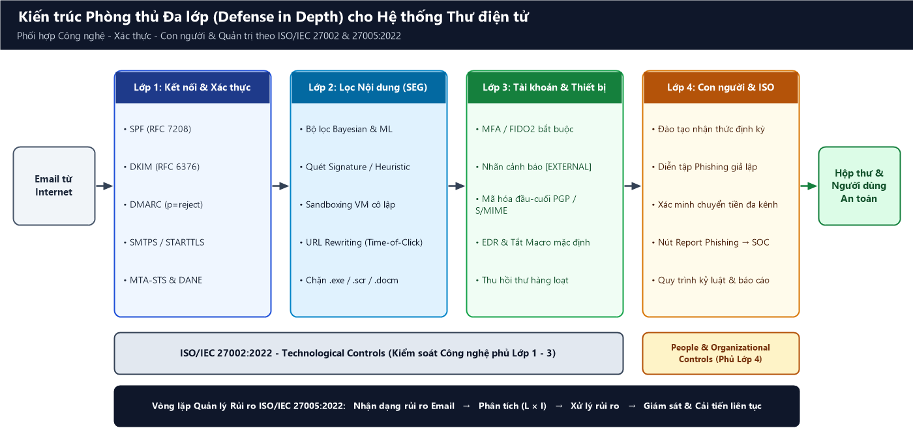

# Chương 4: Đề xuất Giải pháp Phòng thủ Nhiều lớp

> **Sinh viên thực hiện:** Bùi Quang Tùng (`20120397`)  
> **Tài liệu môn học tham khảo:** `Bai 7` (S53-S56), `Bài 8` (S32-S38), `L1` (S14-S19, S29, S32), `Tieu chuan ISO 27000.pptx` (S6-S46, S58-S69)

---

## 4.1. Mô hình Phòng thủ Nhiều lớp (Defense in Depth) cho Email

Trong thực tế vận hành, một biện pháp kỹ thuật riêng lẻ không thể ngăn chặn hết các dạng tấn công qua email. Ví dụ, bộ lọc từ khóa rất dễ bỏ lọt các thư giả danh sếp yêu cầu chuyển khoản (BEC) vì thư chỉ chứa vài câu trao đổi ngắn, không có link lạ hay tệp đính kèm; ngược lại, chuẩn SPF/DKIM/DMARC cũng không tự chặn được email gửi từ một tên miền gần giống mới được kẻ xấu mua hợp pháp (*Lookalike Domain*). 

Vì vậy, hướng tiếp cận phù hợp nhất là xây dựng **mô hình phòng thủ nhiều lớp (Defense in Depth)** (*L1*, Slide 19; *Bai 7*, Slide 50), kết hợp đồng thời ba mảng: **Lọc nội dung & chống mã độc**, **Xác thực & mã hóa**, cùng **Đào tạo nhận thức & quy trình quản trị theo chuẩn ISO**.

*Hình 4.1: Mô hình phòng thủ nhiều lớp (Defense in Depth) cho hệ thống thư điện tử.*

---

## 4.2. Giải pháp Lọc Thư rác & Phòng chống Mã độc

Các lớp lọc này thường được đặt tại cổng kiểm soát email (**Secure Email Gateway - SEG**) kết hợp phần mềm bảo vệ đầu cuối tại máy trạm (*Bai 7*, Slide 55; *Bài 8*, Slide 32-38):
1. **Lọc thư rác bằng thống kê và học máy (Machine Learning):** Phối hợp thuật toán xác suất Bayesian với các mô hình học máy/xử lý ngôn ngữ tự nhiên để đánh giá ngữ cảnh bức thư, tần suất gửi và điểm uy tín IP gửi (*DNSBL/Reputation*).
2. **Quét chữ ký (*Signature*) kết hợp phân tích Heuristic:** So khớp mã băm tệp đính kèm với cơ sở dữ liệu virus đã biết, đồng thời dùng tập luật Heuristic để phát hiện cấu trúc bất thường của biến thể mã độc mới hoặc mã lệnh Macro ẩn bên trong tài liệu.
3. **Cô lập kiểm tra trong môi trường ảo (Sandboxing):** Mở thử các tệp đính kèm nghi vấn (file nén, tài liệu Office, file thực thi) bên trong máy ảo tách biệt để quan sát hành vi tạo tiến trình, sửa Registry hoặc kết nối ra máy chủ điều khiển (C2) trước khi chuyển vào hộp thư nhân viên.
4. **Viết lại liên kết & Kiểm tra tại thời điểm nhấp (URL Rewriting / Time-of-Click):** Chuyển hướng các đường dẫn trong email đi qua máy chủ kiểm tra an toàn ngay lúc người dùng bấm chuột, giúp chặn trường hợp kẻ tấn công đợi email vào hộp thư xong mới đổi trang đích sang trang lừa đảo.
5. **Gắn nhãn cảnh báo email từ bên ngoài (`[EXTERNAL]`):** Tự động chèn nhãn cảnh báo vào tiêu đề hoặc đầu nội dung các thư gửi từ ngoài tên miền công ty, giúp nhân viên nhận ra ngay khi có người mạo danh tên hiển thị của lãnh đạo nội bộ.

---

## 4.3. Xác thực Người gửi & Mã hóa Kênh truyền / Nội dung

- **Triển khai đồng bộ bộ ba `SPF + DKIM + DMARC`:** Quản lý chặt danh sách máy chủ gửi trên SPF (tránh vượt giới hạn 10 lần tra cứu DNS), ký DKIM với độ dài khóa từ 2048-bit trở lên, và áp dụng lộ trình nâng dần chính sách DMARC từ `p=none` (theo dõi báo cáo `RUA`) sang `p=quarantine` rồi khóa ở mức `p=reject`.
- **Bảo vệ kênh truyền bằng `SMTPS / STARTTLS` kết hợp `MTA-STS / DANE`:** Mã hóa lưu lượng SMTP giữa các máy chủ mail để chống nghe lén; bổ sung chính sách `MTA-STS` hoặc `DANE` (dựa trên DNSSEC) nhằm ngăn kẻ tấn công ép hạ cấp kết nối về dạng văn bản rõ (*downgrade attack*).
- **Mã hóa đầu-cuối (`PGP / S/MIME`):** Sử dụng cho các trao đổi chứa hợp đồng, hồ sơ tài chính hoặc dữ liệu nhạy cảm (*Bai 7*, Slide 56). Do việc cấp phát và thu hồi khóa cá nhân khá phức tạp với người dùng phổ thông, doanh nghiệp nên tích hợp quản lý chứng thư số tập trung trên cổng email nội bộ.

---

## 4.4. Nâng cao Nhận thức Người dùng & Quản trị theo ISO/IEC 27002 & 27005

Trong bài giảng *L1* (Slide 15, 29, 32), đào tạo nhận thức an toàn thông tin (*Security Awareness*) được xác định là biện pháp đối phó hiệu quả nhất trước kỹ nghệ xã hội. Để duy trì thường xuyên thay vì làm theo phong trào ngắn hạn, tổ chức có thể áp dụng cấu trúc kiểm soát của **ISO/IEC 27002:2022** và quy trình quản lý rủi ro **ISO/IEC 27005:2022** (*Tieu chuan ISO 27000.pptx*):

| Nhóm biện pháp (`ISO/IEC 27002:2022`) | Cách triển khai cụ thể cho hệ thống Email |
| :--- | :--- |
| **Technological Controls** *(Kiểm soát Công nghệ)* | Bắt buộc xác thực đa yếu tố (**MFA / FIDO2**) cho toàn bộ tài khoản email; trang bị SEG, EDR, IDS/IPS; giám sát nhật ký đăng nhập bất thường và cập nhật bản vá định kỳ cho Mail Server / Mail Client. |
| **People Controls** *(Kiểm soát Con người)* | Tập huấn nhận diện lừa đảo định kỳ sát với từng vị trí công việc (đặc biệt là Kế toán, Nhân sự); tổ chức **diễn tập gửi email Phishing giả lập** hằng quý để đo tỷ lệ bấm nhầm; khuyến khích nhân viên báo cáo sớm thay vì tâm lý sợ bị phạt nên giấu sự cố. |
| **Organizational Controls** *(Kiểm soát Tổ chức)* | Ban hành quy định **xác minh qua kênh độc lập** (gọi điện thoại trực tiếp theo danh bạ nội bộ) trước mọi yêu cầu chuyển tiền hoặc thay đổi số tài khoản qua email; tích hợp nút *Report Phishing* để đội ngũ IT/SOC thu hồi thư độc hàng loạt trên toàn hệ thống. |

*Bảng 4.1: Ánh xạ 3 nhóm kiểm soát ISO/IEC 27002:2022 cho bảo mật Email.*

### Đánh giá & Xử lý Rủi ro Email theo ISO/IEC 27005:2022

Dựa trên quy trình đánh giá rủi ro của **ISO/IEC 27005:2022** (*Tieu chuan ISO 27000.pptx*, Slide 58-69), nhóm thiết lập thang điểm từ `1` đến `5` cho **Khả năng xảy ra ($L$)** và **Mức độ hậu quả ($I$)**, với điểm rủi ro tính theo $R = L \times I$ (`1-5`: Thấp, `6-11`: Trung bình, `12-16`: Cao, `17-25`: Rất cao). *Bảng 4.2* minh họa kế hoạch xử lý cho 4 kịch bản rủi ro sát thực tế:

| Mã | Kịch bản rủi ro & Bộ phận chịu ảnh hưởng | $L$ | $I$ | Điểm ban đầu | Biện pháp kiểm soát giảm thiểu | Rủi ro còn lại |
| :-: | :--- | :-: | :-: | :-: | :--- | :-: |
| **R1** | **Giả danh lãnh đạo (BEC)** yêu cầu chuyển khoản gấp *(Phòng Tài chính - Kế toán)* | 4 | 5 | **20 (Rất cao)** | Bật DMARC `p=reject`, gắn nhãn `[EXTERNAL]`, bắt buộc gọi điện xác nhận trước khi duyệt chi, tập huấn tình huống BEC. | **6 (Trung bình)** |
| **R2** | **Tệp đính kèm chứa mã độc** (`.pdf.exe`, Macro `.docm`) gây nhiễm Ransomware *(Toàn mạng nội bộ)* | 4 | 5 | **20 (Rất cao)** | Chặn đuôi thực thi tại SEG, chạy thử trên Sandbox VM, vô hiệu hóa Macro từ Internet qua Group Policy, cài EDR & sao lưu định kỳ. | **4 (Thấp)** |
| **R3** | **Phishing qua tên miền gần giống / Punycode** làm lộ mật khẩu nhân viên *(Người dùng cuối / IT)* | 5 | 4 | **20 (Rất cao)** | Bật kiểm tra link Time-of-Click, bắt buộc MFA/FIDO2 kháng phishing, tổ chức diễn tập nhận diện định kỳ. | **6 (Trung bình)** |
| **R4** | **Kẻ xấu mạo danh tên miền công ty** gửi thư lừa đối tác/khách hàng *( Quản trị hệ thống / Thương hiệu)* | 3 | 4 | **12 (Cao)** | Cấu hình chuẩn SPF (`-all`) + DKIM 2048-bit + DMARC `p=reject`, theo dõi báo cáo `RUA` hằng ngày và triển khai **BIMI**. | **3 (Thấp)** |

*Bảng 4.2: Đánh giá và xử lý rủi ro Email theo quy trình ISO/IEC 27005:2022.*

---

## 4.5. Bảng Kiểm tra Thực hành & Đối chiếu Giải pháp

| Nhóm đối tượng | Các bước kiểm tra cần thực hiện |
| :--- | :--- |
| **Quản trị viên hệ thống (IT)** | `[ ]` Cấu hình đầy đủ SPF (`-all` hoặc `~all`), DKIM (từ 2048-bit) và lộ trình DMARC lên `p=reject`. `[ ]` Bật mã hóa TLS trên SMTP và kích hoạt MFA cho 100% tài khoản người dùng. `[ ]` Chặn tệp thực thi (`.exe`, `.scr`, `.vbs`, `.js`, `.iso`) và kiểm soát tài liệu có Macro tại cổng nhận thư. `[ ]` Bật nhãn cảnh báo `[EXTERNAL]` và nút báo cáo nhanh *Report Phishing* trên trình đọc mail. |
| **Người dùng cuối** | `[ ]` Kiểm tra kỹ địa chỉ thật trong dấu `<...>` (`From`, `Reply-To`) khi gặp thư hối thúc hoặc liên quan tiền bạc. `[ ]` Rê chuột xem đường dẫn thực tế trước khi bấm; tránh nhập mật khẩu từ link mở trong email. `[ ]` Không mở file có hai đuôi mở rộng (`.pdf.exe`) và không bấm *Enable Macros* với file tải từ email lạ. `[ ]` Luôn gọi điện xác nhận lại khi nhận yêu cầu chuyển khoản hoặc đổi số tài khoản thanh toán. |

*Bảng 4.3: Danh mục kiểm tra an toàn Email cho Quản trị viên IT & Người dùng cuối.*

### Đối chiếu giữa Mối đe dọa, Cơ chế Xác thực và Giải pháp

| Hình thức tấn công (Chương 2) | Vai trò của SPF/DKIM/DMARC (Chương 3) | Lớp bảo vệ phối hợp xử lý (Chương 4) |
| :--- | :--- | :--- |
| **Phishing đánh cắp tài khoản** (`Mẫu 2`) | DMARC `p=reject` chặn mạo danh trực tiếp tên miền ngân hàng | Lọc nội dung ML + URL Rewriting + MFA/FIDO2 + Tập huấn người dùng |
| **Email Spoofing / BEC** (`Mẫu 3`) | Kiểm tra khớp định danh (Alignment) phát hiện `Header From` giả | Chính sách `p=reject` + Nhãn `[EXTERNAL]` + Quy định xác minh đa kênh |
| **Giả mạo tên miền / Punycode** (`Mẫu 4`) | `SPF=PASS` vẫn có thể xảy ra nếu kẻ xấu tự cấu hình cho miền giả | Chặn tên miền mới đăng ký + Cảnh báo Punycode + Kỹ năng soi URL |
| **Tệp đính kèm độc hại** (`Mẫu 5`) | Chỉ xác minh nguồn gửi, không kiểm tra được mã độc bên trong file | Chặn đuôi kép `.pdf.exe` tại SEG + Sandbox VM + Khóa Macro + EDR |

*Bảng 4.4: Đối chiếu giữa Tấn công (Chương 2), Xác thực (Chương 3) và Giải pháp (Chương 4).*
