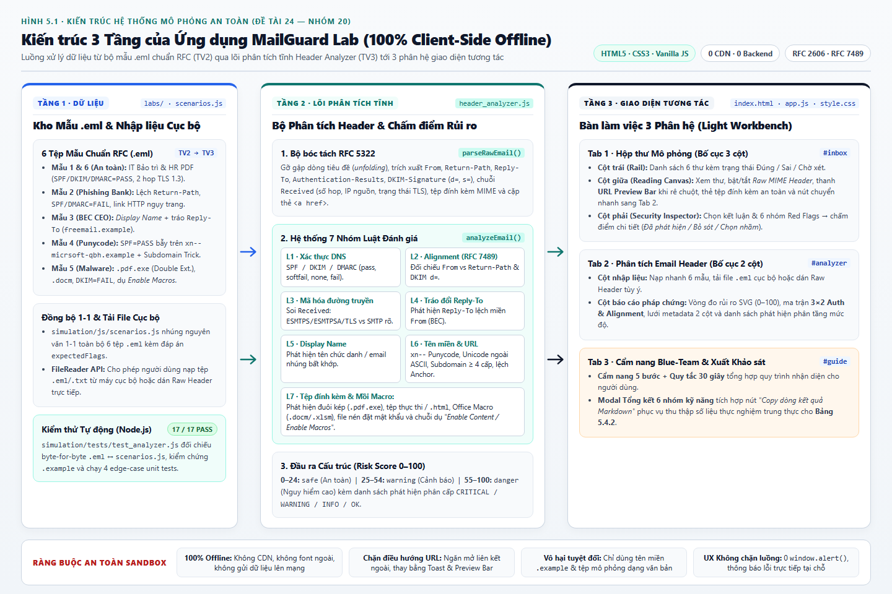
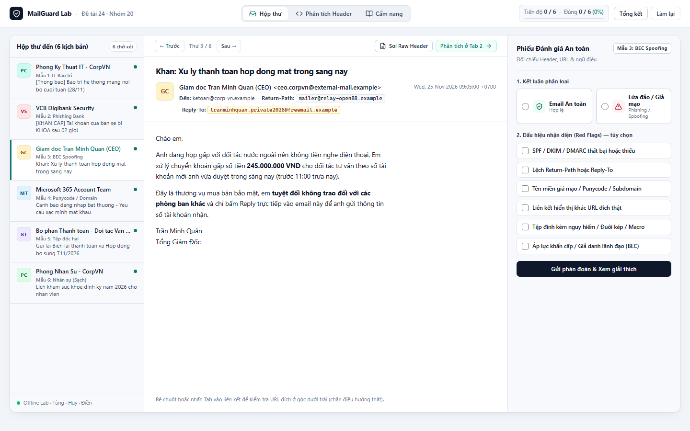
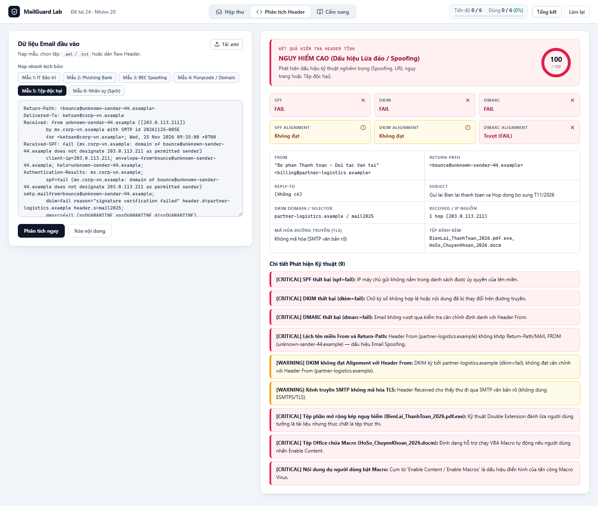

# Chương 5: Xây dựng Tình huống Mô phỏng Nhận diện Email Lừa đảo

> **Sinh viên thực hiện:** Nguyễn Lê Hữu Điền (`23120233`, *Auth & Simulation Engineer*)  
> **Phối hợp mẫu dữ liệu:** Nguyễn Gia Huy (`23120273` — bộ 6 mẫu `.eml` chuẩn RFC & tài liệu đáp án [scenarios_guide.md](../labs/email_samples/scenarios_guide.md))  
> **Mã nguồn ứng dụng:** [simulation/index.html](../simulation/index.html), [header_analyzer.js](../simulation/js/header_analyzer.js), [scenarios.js](../simulation/js/scenarios.js), [app.js](../simulation/js/app.js), [test_analyzer.js](../simulation/tests/test_analyzer.js)

---

## 5.1. Mục tiêu, Phạm vi và Nguyên tắc An toàn Môi trường Mô phỏng

Trong các chương trước, nhóm đã phân tích các kỹ thuật tấn công email phổ biến (Chương 2), cơ chế xác thực `SPF / DKIM / DMARC` gắn với khảo sát DNS thực tế (Chương 3) và mô hình phòng thủ nhiều lớp *Defense in Depth* theo chuẩn ISO/IEC 27002 & 27005 (Chương 4). Tuy nhiên, yếu tố con người vẫn thường là mắt xích dễ bị khai thác nhất khi đối mặt với các kịch bản *Business Email Compromise (BEC)* hoặc tên miền giả mạo *Punycode* vượt qua `SPF=PASS`. Do đó, Chương 5 tập trung xây dựng một **ứng dụng mô phỏng thực hành trực quan (*MailGuard Lab*)** đáp ứng 4 nguyên tắc cốt lõi về kỹ thuật và đạo đức an toàn thông tin:

1. **Vận hành 100% cục bộ (*Client-Side Offline*):** Toàn bộ ứng dụng được phát triển bằng **HTML5, CSS3 và Vanilla JavaScript thuần**, không gọi thư viện CDN bên ngoài, không tải phông chữ từ Internet và không gửi bất kỳ dữ liệu nào ra máy chủ bên ngoài. Thiết kế này bảo đảm hệ thống hoạt động ổn định trong môi trường phòng học không có mạng và loại bỏ hoàn toàn rủi ro rò rỉ dữ liệu người dùng.
2. **Dữ liệu mô phỏng vô hại chuẩn RFC:** Toàn bộ 6 tệp email mẫu `.eml` chỉ sử dụng tên miền dành riêng cho tài liệu `.example` (`RFC 2606`) và các dải IP tài liệu `198.51.100.0/24`, `203.0.113.0/24` (`RFC 5737`). Mọi tệp đính kèm nguy hiểm mô phỏng (`.pdf.exe`, `.docm`) chỉ là nội dung văn bản `text/plain` vô hại kèm siêu dữ liệu mô tả, **tuyệt đối không chứa mã thực thi, VBA Macro hay mã độc thật**.
3. **Cơ chế Sandbox ngăn điều hướng thật:** Tất cả liên kết trong nội dung email mô phỏng được gắn thuộc tính `data-url` thay vì điều hướng trực tiếp; khi người dùng rê chuột (*hover*) hoặc di chuyển bằng phím `Tab`, ứng dụng hiển thị thanh **URL Preview Bar** mô phỏng thanh trạng thái trình duyệt ở góc dưới trái để luyện kỹ năng soi tên miền đích. Nếu người dùng bấm nhầm vào liên kết hoặc tệp đính kèm, ứng dụng chặn hoàn toàn hành vi mở ngoài và hiển thị thông báo phi chặn luồng (*non-blocking Sandbox Toast*, không sử dụng hộp thoại `window.alert()`).
4. **Kết hợp huấn luyện hành vi và kiểm chứng pháp chứng tĩnh:** Ứng dụng không chỉ dừng ở bài trắc nghiệm *An toàn / Lừa đảo* mà còn tích hợp **Bộ Phân tích Email Header tĩnh (`EmailHeaderAnalyzer`)** cho phép người học chuyển trực tiếp bức thư đang xem sang Tab 2 hoặc tải bất kỳ file `.eml` nào từ máy cá nhân để đối chiếu kết quả chấm điểm tự động.

---

## 5.2. Kiến trúc Hệ thống và Thiết kế Ứng dụng Mô phỏng (`simulation/`)

### 5.2.1. Kiến trúc 3 tầng (*Data – Core Engine – Interactive UI*)

Hệ thống được tổ chức theo mô hình phân tầng rõ ràng nhằm tách biệt dữ liệu kịch bản (do Thành viên 2 thiết kế chuẩn hóa), lõi xử lý phân tích Header và lớp giao diện tương tác (do Thành viên 3 xây dựng và kiểm thử), như minh họa tại *Hình 5.1*.


*Hình 5.1: Kiến trúc 3 tầng của ứng dụng MailGuard Lab — luồng xử lý từ kho mẫu `.eml` chuẩn RFC qua lõi `header_analyzer.js` tới 3 phân hệ giao diện.*

- **Tầng 1 — Dữ liệu đầu vào (`labs/email_samples/*.eml` & `simulation/js/scenarios.js`):** Lưu trữ 6 tệp `.eml` chuẩn RFC 5322 cùng bản đồng bộ 1-1 dạng mảng đối tượng `EMAIL_SCENARIOS` (chứa nguyên văn `rawEml`, nội dung hiển thị `bodyHtml`, siêu dữ liệu tệp đính kèm, đáp án `verdict`, danh sách cờ `expectedFlags` và lời giải chi tiết). Ngoài ra, Tab 2 sử dụng `FileReader API` của trình duyệt để đọc trực tiếp các tệp `.eml`/`.txt` cục bộ do người dùng tải lên.
- **Tầng 2 — Lõi phân tích tĩnh (`simulation/js/header_analyzer.js`):** Cung cấp hai hàm trọng tâm là `parseRawEmail(rawText)` (gỡ gập dòng tiêu đề *header unfolding* theo RFC 5322, trích xuất trường địa chỉ, chuỗi `Received`, `Authentication-Results`, `DKIM-Signature`, danh sách tệp đính kèm và cặp `<a href>`/`anchorText`) và `analyzeEmail(rawText)` (chấm điểm rủi ro `0–100` theo 7 nhóm luật kỹ thuật). Module được thiết kế theo chuẩn kép (*dual-mode*) để chạy trực tiếp cả trên trình duyệt (`window.EmailHeaderAnalyzer`) lẫn môi trường Node.js phục vụ kiểm thử tự động (`module.exports`).
- **Tầng 3 — Giao diện tương tác (`simulation/index.html`, `css/style.css`, `js/app.js`):** Triển khai bàn làm việc nền sáng (*Light-Mode Desktop Security Workbench*) gồm thanh điều hướng hợp nhất phía trên (chuyển đổi 3 phân hệ, thanh tiến độ thời gian thực, nút *Tổng kết* và *Làm lại*) và cơ chế định tuyến theo hash (`#inbox?sample=...`, `#analyzer?sample=...`, `#guide`) hỗ trợ trình chiếu demo mượt mà.

### 5.2.2. Thiết kế 3 Phân hệ Chức năng

1. **Phân hệ 1 — Hộp thư Mô phỏng (`#inbox`, bố cục 3 cột):**
   - **Cột trái (*Inbox Rail*):** Liệt kê toàn bộ kịch bản kèm tên người gửi, tiêu đề rút gọn và huy hiệu trạng thái trực quan (*Chờ xét*, *Đúng*, *Sai*).
   - **Cột giữa (*Reading Canvas*):** Hiển thị bức thư giống trình duyệt email doanh nghiệp với thanh công cụ điều hướng *Trước / Sau*, nút **Soi Raw Header** (mở khung mã nguồn MIME kèm tô sáng tên trường tiêu đề và bộ huy hiệu `SPF / DKIM / DMARC`), nút **Phân tích ở Tab 2** (chuyển toàn bộ Raw EML sang bộ phân tích chỉ bằng một cú bấm), cảnh báo nổi bật trường `Reply-To` khi có mặt, dải tệp đính kèm mô phỏng và thanh **URL Preview Bar** ở góc dưới trái.
   - **Cột phải (*Security Inspector*):** Cho phép người dùng chọn phán đoán (*Email An toàn* hoặc *Lừa đảo / Giả mạo*) kết hợp tick chọn 6 nhóm dấu hiệu *Red Flags*. Khi gửi kết quả, hệ thống đối chiếu tập cờ đã chọn với đáp án chuẩn để tách bạch 3 nhóm phản hồi: **Red Flags đã phát hiện (*Caught*)**, **Red Flags bị bỏ sót (*Missed*)** và **Dấu hiệu chọn dư/nhầm (*Extra*)**, kèm lời giải thích kỹ thuật chi tiết.


*Hình 5.2: Phân hệ 1 (Hộp thư Mô phỏng 3 cột) tại Mẫu 3 — nổi bật địa chỉ gửi ngoài `ceo.corpvn@external-mail.example`, `Return-Path` lệch và thẻ cảnh báo `Reply-To` trỏ về `freemail.example`.*

2. **Phân hệ 2 — Bộ Phân tích Email Header (`#analyzer`, bố cục 2 cột):**
   - **Cột trái (Nhập liệu):** Gồm dải nút nạp nhanh 6 kịch bản mẫu, nút tải file `.eml`/`.txt` cục bộ và vùng nhập văn bản Raw Header tự do.
   - **Cột phải (Báo cáo Pháp chứng):** Hiển thị thẻ kết luận mức độ rủi ro tích hợp **vòng đo điểm SVG (`0–100`)**, **ma trận 3×2 Xác thực & Căn chỉnh định danh** (hàng 1: `SPF / DKIM / DMARC`; hàng 2: `SPF Alignment / DKIM Alignment / DMARC Alignment`), **lưới siêu dữ liệu 2 cột** (`From`, `Return-Path`, `Reply-To`, `Subject`, `DKIM Domain/Selector`, `Received/IP nguồn`, `Mã hóa đường truyền TLS`, `Tệp đính kèm`) và danh sách các phát hiện kỹ thuật phân cấp màu theo mức độ (`CRITICAL`, `WARNING`, `INFO`, `OK`).


*Hình 5.3: Phân hệ 2 (Bộ Phân tích Email Header) phân tích tự động Mẫu 5 — chấm điểm rủi ro `100/100`, chỉ rõ thất bại toàn bộ 3 lớp xác thực, lệch Alignment, truyền `SMTP` không TLS cùng 3 cảnh báo nghiêm trọng về `.pdf.exe`, `.docm` và mồi `Enable Macros`.*

3. **Phân hệ 3 — Cẩm nang Blue-Team (`#guide`) & Modal Tổng kết Khảo sát:**
   - Trình bày quy trình kiểm tra email 5 bước cùng **Quy tắc 30 giây** (*Ai gửi thật? — Có được xác thực? — Hành động an toàn?*) để người học hệ thống hóa kiến thức ngay sau khi hoàn thành bài thực hành.
   - Cửa sổ **Tổng kết (*Summary Modal*)** thống kê 3 chỉ số KPI (tiến độ, tỷ lệ phán đoán đúng, độ phủ Red Flags), bảng kết quả từng kịch bản, biểu đồ thanh tỷ lệ nhận diện theo **6 nhóm kỹ năng**, và đặc biệt tích hợp công cụ **Copy dòng kết quả Markdown** xuất đúng định dạng bảng phục vụ ghi nhận số liệu thực nghiệm trung thực ở Mục 5.4.2.

### 5.2.3. Hệ thống 7 Nhóm Luật Đánh giá trong `header_analyzer.js`

Để mô phỏng sát cơ chế chấm điểm của một cổng bảo mật email (*Secure Email Gateway*) ở mức nguyên lý, hàm `analyzeEmail()` tổng hợp điểm rủi ro trên thang `0–100` (giới hạn trần tại `100`) dựa trên 7 nhóm luật định lượng ở *Bảng 5.1*:

| Nhóm luật | Tiêu chí kiểm tra kỹ thuật | Trọng số điểm | Mức độ cảnh báo |
| :---: | :--- | :---: | :---: |
| **L1 · Xác thực DNS** | Đọc `Authentication-Results`: `spf=fail` (`+25`), `softfail` (`+15`), `none` (`+10`); `dkim=fail` (`+25`), `none` (`+10`); `dmarc=fail` (`+25`), `none` (`+15`). | `+10` → `+75` | `CRITICAL` / `WARNING` / `OK` |
| **L2 · Alignment (`RFC 7489`)** | Đối chiếu tên miền gốc (*Registrable Domain*) giữa `Header From` với `Return-Path`/`smtp.mailfrom` (`+20` nếu lệch) và `DKIM d=` (`+15` nếu ký không đạt Alignment). | `+15` → `+35` | `CRITICAL` / `WARNING` / `OK` |
| **L3 · Truyền tải TLS** | Quét toàn bộ chuỗi `Received` (từ hop cuối ngược về hop đầu để trích IP nguồn): nhận diện `ESMTPS`/`ESMTPSA`/`TLS` so với `SMTP` văn bản rõ (`+10`). | `+10` | `WARNING` / `OK` |
| **L4 · Tráo `Reply-To`** | Kiểm tra miền `Reply-To` khác tên miền đăng ký gốc của `Header From` (dấu hiệu điển hình của tấn công BEC). | `+30` | `CRITICAL` |
| **L5 · Display Name** | Phát hiện địa chỉ email nhúng trong tên hiển thị lệch miền gửi (`+25`) hoặc chức danh/thương hiệu nhạy cảm (*CEO, Giám đốc, Bank, Security, Microsoft*) khi DMARC/Reply-To không an toàn (`+15`). | `+15` → `+25` | `CRITICAL` / `WARNING` |
| **L6 · Tên miền & URL** | Phát hiện tiền tố Punycode `xn--` (`+35`), ký tự Unicode ngoài bảng ASCII (`+35`), cấu trúc subdomain dài ≥ 4 cấp (`+20`) và liên kết ngụy trang (*Anchor Text host ≠ href host*, `+30`). | `+20` → `+85` | `CRITICAL` / `WARNING` |
| **L7 · Tệp đính kèm & Macro** | Phát hiện đuôi kép `.xxx.exe/.scr/.vbs...` (`+40`), tệp thực thi hoặc `.html` Smuggling (`+35`), tài liệu Office chứa Macro `.docm/.xlsm` (`+30`), file nén kèm mật khẩu (`+20`) và nội dung dụ *"Enable Content / Enable Macros"* (`+25`). | `+20` → `+95` | `CRITICAL` / `WARNING` / `INFO` |

*Bảng 5.1: Tổng hợp 7 nhóm luật kỹ thuật và trọng số chấm điểm rủi ro trong `simulation/js/header_analyzer.js`.*

Ngưỡng phân loại cuối cùng được quy ước như sau: **`0–24` → `safe`** (*Mức rủi ro thấp / Email an toàn*), **`25–54` → `warning`** (*Cảnh báo — cần kiểm tra thủ công*), **`55–100` → `danger`** (*Nguy hiểm cao — dấu hiệu lừa đảo / giả mạo*).

---

## 5.3. Bộ 6 Kịch bản Tình huống Mẫu Đồng bộ với Dữ liệu `.eml`

Bộ 6 kịch bản tích hợp trong `simulation/js/scenarios.js` được đồng bộ chính xác từng byte với 6 tệp `.eml` chuẩn hóa tại thư mục [labs/email_samples/](../labs/email_samples/) (chi tiết phân tích đáp án xem tại [scenarios_guide.md](../labs/email_samples/scenarios_guide.md)). Cấu trúc bộ mẫu bao gồm **2 email hợp lệ** (có và không có tệp đính kèm sạch để đo tỷ lệ báo động giả *False Positive*) và **4 kịch bản tấn công đại diện** bao phủ đầy đủ các nhóm kỹ thuật ở Chương 2:

| STT | Tệp mẫu `.eml` | Kịch bản mô phỏng | Đáp án | Xác thực (`SPF / DKIM / DMARC`) | Kỹ năng & Dấu hiệu kiểm tra trọng tâm |
| :-: | :--- | :--- | :---: | :---: | :--- |
| **1** | `sample_01_legit_it.eml` | Phòng IT (`corp-vn.example`) thông báo bảo trì định kỳ | **An toàn** | `PASS / PASS / PASS` (`p=REJECT`) | Khớp hoàn toàn `From / Return-Path / DKIM d=`, truyền 2 hop nội bộ `TLS 1.3`, URL HTTPS trùng khớp 100%, không yêu cầu mật khẩu. |
| **2** | `sample_02_phishing_bank.eml` | Giả mạo VCB Digibank dọa khóa tài khoản sau 02 giờ | **Lừa đảo** | `FAIL / NONE / FAIL` (`p=QUARANTINE`) | Tâm lý khẩn cấp (*"BỊ KHÓA VĨNH VIỄN SAU 02 GIỜ"*), lệch `Return-Path` (`promo-mailer-99.example`), truyền `SMTP` rõ, liên kết hiển thị khác URL đích HTTP (`login-verify.example`). |
| **3** | `sample_03_spoofing_ceo_bec.eml` | Giả danh Tổng Giám đốc yêu cầu chuyển khoản gấp `245.000.000 VND` | **Lừa đảo** | `SOFTFAIL / NONE / FAIL` (`p=NONE`) | *Display Name Spoofing* (`ceo.corpvn@external-mail.example` né chính sách `p=REJECT` của `corp-vn.example`), gửi qua `relay-open88.example`, đánh tráo `Reply-To` sang `freemail.example`, cô lập nạn nhân khỏi gọi điện xác minh. |
| **4** | `sample_04_lookalike_domain.eml` | Cảnh báo đăng nhập giả mạo Microsoft 365 | **Lừa đảo** | `PASS* / NONE / NONE` | **Bẫy kỹ thuật `SPF=PASS` + `TLS 1.2`** trên tên miền giả Punycode chuẩn RFC 3492 **`xn--micrsoft-qbh.example`** (giải mã thành `micrоsoft.example` dùng chữ `о` Cyrillic `U+043E`) kết hợp *Subdomain Trick* trỏ về `account-reset-portal.example`. |
| **5** | `sample_05_malicious_attachment.eml` | Giả danh đối tác vận tải gửi biên lai & hợp đồng bổ sung | **Lừa đảo** | `FAIL / FAIL / FAIL` (`p=QUARANTINE`) | Thất bại cả 3 lớp xác thực (chữ ký `DKIM-Signature` giả mạo/sai hash), lời nhắn cố ý ẩn đuôi `.exe` (`BienLai_ThanhToan_2026.pdf`) trong khi tệp thực là **`BienLai_ThanhToan_2026.pdf.exe`** (đuôi kép) kèm **`HoSo_ChuyenKhoan_2026.docm`** và lời dụ bấm *"Enable Content / Enable Macros"*. |
| **6** | `sample_06_legit_hr.eml` | Phòng Nhân sự (`corp-vn.example`) gửi lịch khám sức khỏe kèm `.pdf` | **An toàn** | `PASS / PASS / PASS` (`p=REJECT`) | Đối chứng kiểm tra *False Positive*: tệp `Lich_Kham_Suc_Khoe_2026.pdf` hợp lệ, 2 hop nội bộ (`hr-portal` → `mail` → `mx`) mã hóa `TLS 1.3`, không có dấu hiệu ép bật Macro. |

*Bảng 5.2: Bảng tổng hợp 6 tình huống mô phỏng đồng bộ 1-1 giữa `labs/email_samples/*.eml` và `simulation/js/scenarios.js`.*

> **Ghi chú minh bạch kỹ thuật:** Tương tự ghi nhận trong [scenarios_guide.md](../labs/email_samples/scenarios_guide.md), các giá trị mã băm thân thư (`bh=`) và chữ ký (`b=`) trong tiêu đề `DKIM-Signature` của các tệp mẫu là chuỗi mô phỏng tĩnh phục vụ huấn luyện ngoại tuyến; bộ phân tích `EmailHeaderAnalyzer` thực hiện đánh giá dựa trên phân tích tĩnh tiêu đề `Authentication-Results`, chữ ký khai báo và các chỉ báo cấu trúc thay vì truy vấn trực tiếp khóa công khai trên DNS Internet.

---

## 5.4. Kết quả Kiểm thử Tự động và Khung Đánh giá Thực nghiệm

### 5.4.1. Kết quả Kiểm thử Tự động Bộ Phân tích Header (`simulation/tests/test_analyzer.js`)

Nhằm bảo đảm độ chính xác của thuật toán phân tích và tính nhất quán tuyệt đối giữa dữ liệu `.eml` với giao diện Web App, nhóm đã xây dựng bộ kiểm thử tự động bằng Node.js tại [simulation/tests/test_analyzer.js](../simulation/tests/test_analyzer.js) (không dùng thư viện ngoài) và thực thi bằng lệnh:

```powershell
node simulation/tests/test_analyzer.js
```

Bộ kiểm thử gồm **17 bài kiểm thử tự động (đạt `17/17 PASS` — 100%)** chia làm 3 nhóm:
1. **Nhóm 1 — Kiểm thử đồng bộ 1-1 và đạo đức dữ liệu (`7/7 PASS`):** Tự động quét toàn bộ thư mục `labs/email_samples/*.eml`, xác minh `scenarios.js` trùng khớp từng byte với từng file `.eml`, đối chiếu nhất quán các trường `From`, `Return-Path`, `Reply-To`, `SPF/DKIM/DMARC` và khẳng định 100% tên miền/URL đều tuân thủ hậu tố `.example` (`RFC 2606`).
2. **Nhóm 2 — Kiểm thử phân tích rủi ro trên cả 6 tệp `.eml` (`6/6 PASS`):** Kiểm chứng điểm rủi ro, phân loại `safe`/`danger`, trạng thái *Alignment*, nhận diện mã hóa TLS, số hop + IP nguồn và đầy đủ các cảnh báo đặc trưng trên từng kịch bản (*Bảng 5.3*).
3. **Nhóm 3 — Kiểm thử biên (*Edge-Case Unit Tests*, `4/4 PASS`):** Kiểm tra đầu vào rỗng (`warning 0/100`), kịch bản chuyển tiếp email (*Email Forwarding*: `SPF=fail` nhưng `DKIM=pass` khớp miền vẫn đạt `DMARC Alignment` kèm nhận diện `ESMTPSA`/`TLS1_3`), tên miền chứa trực tiếp ký tự Unicode Homograph ngoài bảng mã ASCII (`micrоsoft.example` với `U+043E`), và tệp nén `.zip` đi kèm mật khẩu giải nén trong thân thư.

| Tệp `.eml` | Xác thực (`SPF / DKIM / DMARC`) | Alignment (`SPF / DKIM`) | Truyền tải & IP nguồn | Điểm rủi ro | Phân loại | Số phát hiện (`CRIT / WARN / OK`) |
| :--- | :---: | :---: | :---: | :---: | :---: | :---: |
| `sample_01_legit_it.eml` | `PASS / PASS / PASS` | `OK / OK` | `TLS · 2 hop (198.51.100.12)` | **`0 / 100`** | `safe` | `0 CRIT / 0 WARN / 6 OK` |
| `sample_02_phishing_bank.eml` | `FAIL / NONE / FAIL` | `FAIL / FAIL` | `Plain SMTP · 1 hop (203.0.113.88)` | **`100 / 100`** | `danger` | `4 CRIT / 3 WARN / 0 OK` |
| `sample_03_spoofing_ceo_bec.eml` | `SOFTFAIL / NONE / FAIL` | `FAIL / FAIL` | `Plain SMTP · 1 hop (203.0.113.154)` | **`100 / 100`** | `danger` | `3 CRIT / 4 WARN / 0 OK` |
| `sample_04_lookalike_domain.eml` | `PASS / NONE / NONE` | `OK / FAIL` | `TLS · 1 hop (198.51.100.77)` | **`100 / 100`** | `danger` | `2 CRIT / 4 WARN / 3 OK` |
| `sample_05_malicious_attachment.eml` | `FAIL / FAIL / FAIL` | `FAIL / FAIL` | `Plain SMTP · 1 hop (203.0.113.211)` | **`100 / 100`** | `danger` | `7 CRIT / 2 WARN / 0 OK` |
| `sample_06_legit_hr.eml` | `PASS / PASS / PASS` | `OK / OK` | `TLS · 2 hop (198.51.100.15)` | **`0 / 100`** | `safe` | `0 CRIT / 0 WARN / 6 OK` |

*Bảng 5.3: Kết quả thực thi thực tế của bộ kiểm thử tự động `simulation/tests/test_analyzer.js` trên 6 tệp mẫu `.eml`.*

**Nhận xét kỹ thuật từ kết quả kiểm thử:**
- **Độ chính xác phân loại đạt `6/6` (`100% True Positive`, `0% False Positive`):** Hai email hợp lệ (`sample_01`, `sample_06`) đều đạt `0/100 (safe)`, trong đó `sample_06` có đính kèm tệp `Lich_Kham_Suc_Khoe_2026.pdf` chỉ được ghi nhận ở mức thông tin (`INFO`, `+0 điểm`), không gây báo động giả. Toàn bộ 4 email tấn công (`sample_02`–`sample_05`) đều chạm mức rủi ro tối đa `100/100 (danger)`.
- **Giá trị phòng thủ đa lớp thể hiện rõ ở Mẫu 4 (`sample_04_lookalike_domain.eml`):** Dù bức thư có tới **`3 OK`** (`SPF=PASS`, `SPF Alignment đạt chuẩn` trên chính miền giả, và đường truyền mã hóa `TLS 1.2`), công cụ vẫn kết luận **`100/100 (danger)`** nhờ phát hiện chuỗi Punycode `xn--micrsoft-qbh.example` (`+35`), liên kết ngụy trang (`+30`), cấu trúc subdomain 5 cấp (`+20`), thiếu `DKIM/DMARC` (`+25`) và giả mạo tên hiển thị thương hiệu (`+15`). Điều này kiểm chứng thực nghiệm nhận định ở Chương 3 rằng *`SPF=PASS` và `TLS` đơn lẻ không đủ để bảo đảm an toàn email*.
- **Phát hiện trọn vẹn kỹ thuật BEC tinh vi ở Mẫu 3 (`sample_03_spoofing_ceo_bec.eml`):** Khi kẻ tấn công tránh chính sách `p=REJECT` của `corp-vn.example` bằng địa chỉ ngoài `ceo.corpvn@external-mail.example`, hệ thống vẫn bắt giữ chính xác tổ hợp tín hiệu *Display Name Spoofing* + tráo `Reply-To` (`freemail.example`) + lệch `Return-Path` (`relay-open88.example`) + `DMARC=FAIL`.

### 5.4.2. Khung Thực nghiệm Khảo sát Người dùng (Dry-run) & Quy trình Ghi nhận Số liệu

> **Nguyên tắc trung thực khoa học:** Bảng dưới đây là **khung thu thập số liệu thực nghiệm trực tiếp** sẵn sàng để cả nhóm tiến hành chạy thử (*Dry-run*) với `5–10` sinh viên / người tham gia trước buổi bảo vệ — nhóm tuyệt đối không điền sẵn hay giả lập số liệu khảo sát ảo.

**Quy trình thực nghiệm đề xuất (mỗi người tham gia mất khoảng `5–7 phút`):**
1. Người thử nghiệm mở trực tiếp [simulation/index.html](../simulation/index.html) trên trình duyệt và tự đánh giá lần lượt cả 6 email tại **Tab 1 (*Hộp thư Mô phỏng*)** mà không xem trước đáp án (khuyến khích sử dụng nút *Soi Raw Header* và rê chuột soi link).
2. Sau khi hoàn tất 6 kịch bản, người thử nghiệm bấm nút **Tổng kết** trên thanh công cụ để xem thống kê tỷ lệ chính xác theo **6 nhóm kỹ năng Red Flags**.
3. Nhập bí danh người thử nghiệm vào ô xuất khảo sát, bấm **Copy dòng kết quả Markdown** và dán nguyên dòng vào *Bảng 5.4* bên dưới.

| Người thử nghiệm | Số mẫu đúng (lần đầu / 6) | Mẫu hay nhầm nhất | Nhận xét & Kỹ năng cần cải thiện sau khi xem giải thích Red Flags |
| :--- | :---: | :--- | :--- |
| *(Chờ nhóm thu thập thực nghiệm)* | `.../6` | *(Dán trực tiếp từ nút Copy dòng Markdown trong Modal Tổng kết)* | *(Ghi nhận nhóm Red Flag bỏ sót nhiều nhất và đánh giá hiệu quả của hướng dẫn soi Header / Hover URL)* |

*Bảng 5.4: Khung ghi nhận kết quả thực nghiệm người dùng (Dry-run) thu thập trực tiếp từ ứng dụng MailGuard Lab.*

**Các tiêu chí phân tích sau khi tổng hợp đủ `5–10` lượt thử nghiệm:**
- **Tỷ lệ chính xác trung bình ban đầu** và **mức độ nhận diện False Positive** trên Mẫu 6 (liệu người dùng có xu hướng nghi ngờ nhầm tệp `.pdf` sạch vì tâm lý cảnh giác cao sau khi xem Mẫu 5 hay không).
- **Nhóm kịch bản gây nhầm lẫn cao nhất:** Đối chiếu xem Mẫu 4 (bẫy `SPF=PASS` + Punycode) hay Mẫu 3 (*Display Name Spoofing* giả danh CEO không có đường dẫn độc hại) dễ đánh lừa người dùng nhất.
- **Độ phủ theo 6 nhóm kỹ năng Red Flags:** Đánh giá xem người dùng dễ phát hiện yếu tố nội dung (tâm lý khẩn cấp, tệp `.pdf.exe`) hơn hay yếu tố kỹ thuật trong Header (`Return-Path`, `Reply-To`, `DMARC Alignment`) hơn, từ đó khẳng định vai trò thiết yếu của đào tạo nhận thức kết hợp công cụ cảnh báo kỹ thuật như đã đề xuất ở Chương 4.
